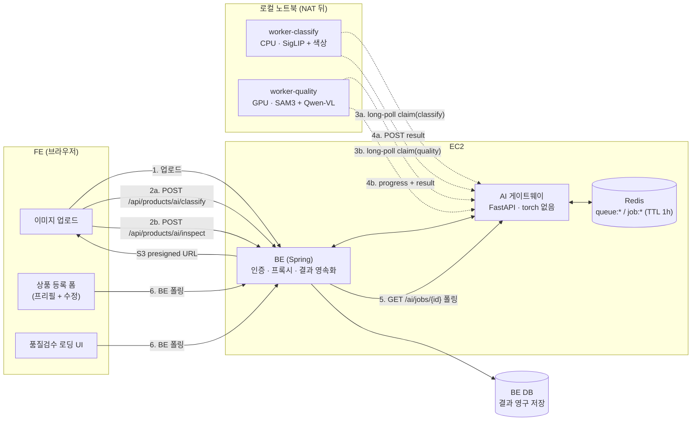
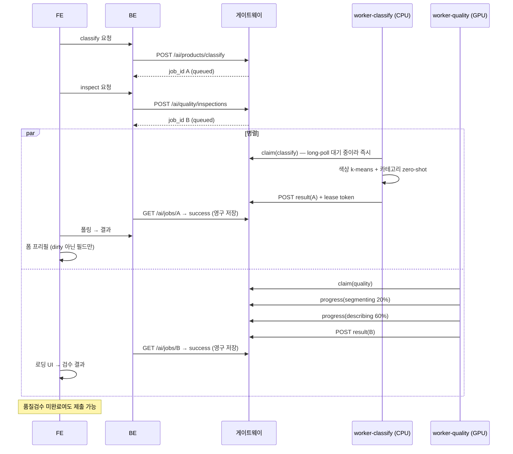

# CH012 — 상품 정보 분류(`product_info_classify`) 병렬 파이프라인 설계

> 상품 등록 폼 프리필용 상품 속성(색상·카테고리) 분류를, 기존 품질검수 파이프라인과 **병렬로** 돌리기 위한 아키텍처 설계.
>
> **결론 요약** — 엔드포인트 2개 / job 2개 / 큐 2개 / 워커 프로세스 2개로 분리한다. 다만 진짜 직렬화 지점은 API가 아니라 **단일 GPU 노트북**이므로, 상품정보 슬롯은 **GPU를 쓰지 않는 백엔드를 기본값**으로 둔다. 그리고 Redis는 **전달 버퍼일 뿐 저장소가 아니다** — 결과의 소유권은 BE에 있다.

---

## 1. 배경과 목표

### 1.1 UX 요구사항
사용자가 상품 사진을 올리면:

1. 두 파이프라인이 **동시에** 시작한다.
2. 상품정보 분류(가벼움)가 먼저 끝나 폼의 색상·카테고리 필드를 **프리필**한다. 사용자는 이를 수정할 수 있다.
3. 품질검수(무거움: SAM3 + 설명 VLM)는 그동안 **로딩 UI**로 계속 돈다.
4. 사용자는 품질검수 완료를 기다리지 않고 상품 등록을 **제출할 수 있어야 한다**.

4번은 원 요구사항에 없지만 가장 중요하다. 폼 제출이 품질검수를 기다린다면 앞에서 병렬화로 번 시간을 마지막에 전부 반납한다. → §8.2

### 1.2 이 설계를 지배하는 인프라 제약

| 구성요소 | 위치 | 제약 |
|---|---|---|
| FastAPI 게이트웨이 | EC2 | `mem_limit: 1g`, torch 없음, GPU 없음 → **추론 불가** |
| 워커 | 팀원 로컬 노트북 (conda) | GPU 1대. 공유기 뒤 → **인바운드 불가**, 아웃바운드 폴링만 |
| GPU 서버 | — | sudo 막힘 → 환경 구성 불가, 사실상 사용 불가 |
| Redis | EC2 | job 큐 + 결과 **임시** 저장, TTL 1시간 |

**추론 자원은 노트북 GPU 1대가 전부다.** 이 한 문장이 §2의 결론을 강제한다.

### 1.3 부하 가정 (명시하지 않으면 전체 지연 예산이 무의미해짐)

시연·프로토타입 기준으로 **동시 등록 사용자 ≤ 3명**을 가정한다.

- classify는 워커 내부에서 **동시 2건**까지 처리(CPU 스레드 2). 건당 1.5초 × 3명 ≈ 최악 3초.
- quality는 **동시 1건**(GPU 1대). 3명이 몰리면 3번째는 최악 9분 → FE 타임아웃 5분을 넘긴다.
- 따라서 게이트웨이는 **큐 깊이 기반 백프레셔**를 건다: `queue:quality_check` 깊이가 임계(예: 3)를 넘으면 202 대신 `202 + estimated_wait_seconds`를 반환하고, FE는 "검수 대기 N분" 안내 후 등록만 진행시킨다.

이 가정이 깨지는 규모(동시 10명 이상)에서는 노트북 GPU 구조 자체를 바꿔야 하며, 그건 이 설계의 범위 밖이다.

---

## 2. 진짜 병목 — 병렬성은 API가 아니라 GPU에서 결정된다

엔드포인트를 둘로 나누고 job을 둘 만들어도, 두 job이 같은 GPU 위에서 순차 실행되면 UX는 전혀 개선되지 않는다.

```
[나쁜 경우] 단일 워커 루프, 단일 큐
t=0     classify job + quality job 동시 enqueue
t=0     워커가 quality job을 먼저 집음
t=0~90  SAM3 + finding VLM 설명 …… classify job은 큐에서 90초 대기
t=90    classify 실행 → 폼 프리필
→ 사용자는 90초 동안 빈 폼을 본다. 병렬화 실패.
```

핵심 질문은 "엔드포인트를 어떻게 나눌까"가 아니라 **"두 작업이 같은 GPU를 놓고 싸우지 않게 하려면 무엇을 포기해야 하는가"** 다.

### 2.1 선택지 비교

| 방안 | 내용 | 평가 |
|---|---|---|
| **A. 상품정보를 GPU 밖으로** | CPU에서 도는 경량 모델(CLIP/SigLIP zero-shot) + 고전 CV 색상 추출 | ✅ **채택(기본값)**. 자원 경합이 사라짐. 태스크가 closed-set 분류라 VLM이 과잉 |
| B. 워커 2개, 둘 다 GPU | classify 워커에 Qwen3-VL 별도 로드 | VRAM 이중 적재(추정 4GB×2 + SAM3). VRAM 미측정 → 리스크. **옵트인** |
| C. 단일 프로세스 + 협조적 선점 | quality 스테이지 경계에서 classify 큐 확인 후 양보 | 구현 복잡. SAM3 스테이지 하나가 길면 여전히 지연 |
| D. 우선순위 큐만 | classify 큐를 항상 먼저 드레인 | job 단위 선점이라 실행 중인 quality job은 못 비킴 → 최악 지연 그대로 |

### 2.2 왜 상품정보에 VLM이 기본값이 아닌가

품질검수의 VLM 설명은 **열린 생성**(하자를 자연어로 서술)이라 VLM이 필요하다. 반면 상품정보 분류는 **닫힌 집합 분류**다.

- **카테고리** — 고정 taxonomy에서 하나를 고르는 문제. 라벨 텍스트를 임베딩해 두고 이미지 임베딩과 코사인 유사도만 계산(zero-shot). 모델 ~0.4GB, CPU 1초 이내로 추정.
- **색상** — 배경 제외 마스크에서 k-means로 대표색을 뽑아 **고정 팔레트에 스냅**하는 편이 정확하고 빠르다. VLM에 색을 물으면 "차콜 그레이 계열의 다크 네이비" 같은, 폼 select에 못 넣는 값이 나온다.

품질검수 VLM 도입 때 실측으로 확인된 교훈 — **정확히 계산 가능한 값을 VLM에 물으면 hallucination이 난다, 계산해서 붙여라**(위치는 `Finding.section`에서 가져옴) — 가 그대로 적용된다. **색상은 계산 가능한 값이다.**

### 2.3 `include_attributes`를 요청 플래그로 두지 않는다 — 설계 결정

브랜드·패턴·소재처럼 텍스트 인식이나 세밀한 시각 추론이 필요한 속성은 zero-shot으로 안 된다. 이런 속성은 VLM이 필요하고, VLM은 GPU가 필요하고, GPU는 quality와 경합한다. 즉 **`include_attributes: true`를 FE가 임의로 켤 수 있게 두면 §2.1에서 배제한 문제가 요청 단위로 되살아난다.**

→ 확장 속성 지원 여부는 **워커의 활성 백엔드(환경변수)가 결정**한다. 기존 컨벤션의 "무거운 옵션은 옵트인"은 레지스트리·환경변수 레벨이지 요청 레벨이 아니다.

- 게이트웨이는 `GET /ai/capabilities`로 현재 활성 워커가 지원하는 필드 집합을 노출한다.
- 요청에 `include_attributes`가 없다. 워커가 지원하면 결과에 `attributes`가 실리고, 아니면 `null`이다.
- FE는 `attributes`가 null이면 해당 필드를 그냥 수동 입력으로 둔다.

---

## 3. 시스템 아키텍처

### 3.1 전체 구성

**FE는 게이트웨이를 직접 부르지 않고 BE를 경유한다.** 인증 체계가 이미 BE에 있고, 게이트웨이는 EC2 1GB라 얇게 유지해야 하며, CORS·레이트리밋·워커 토큰 관리를 게이트웨이에 얹지 않기 위해서다. 홉이 하나 늘어나는 비용은 §3.3 예산에 반영했다.



**중요** — 워커가 결과를 올리면 BE가 즉시 회수해 **DB에 영구 저장**한다. Redis job은 전달 버퍼일 뿐이다. TTL 1시간을 결과 보존 기간으로 쓰면 §8.2의 제출 흐름이 반드시 깨진다(사용자가 폼을 1시간 넘게 붙잡는 경우).

### 3.2 타임라인



### 3.3 지연 예산 (실측 후 갱신)

동시 사용자 1명, 이미지 1장 기준. **여유(buffer)를 명시적으로 남긴다** — 아래 항목 합이 목표와 같으면 실제로는 항상 초과한다.

| 구간 | 목표 |
|---|---|
| FE → BE → GW 왕복 (POST) | ≤ 0.15s |
| 큐 대기 (long-poll) | ≤ 0.2s |
| 이미지 다운로드 (워커 → S3) | ≤ 0.8s |
| 추론 (CPU) | ≤ 1.5s |
| 워커 → GW 결과 업로드 (가정용 회선 상향) | ≤ 0.3s |
| BE 회수 + FE 폴링 감지 (500ms 간격) | ≤ 0.7s |
| **소계** | **3.65s** |
| 여유 | 1.35s |
| **classify p95 목표** | **≤ 5s** |

> 앞선 초안은 3초 목표에 합이 정확히 3.0초여서 여유가 0이었다. BE 프록시 홉과 결과 업로드가 빠져 있었다. **목표를 5초로 현실화**한다.

**quality**: 30s ~ 3min. 단 finding 수에 상한이 없으면 3분을 보장할 수 없다(설명 VLM이 finding당 3~9초). → **finding 설명 대상을 severity 상위 N개(기본 6개)로 캡**하고, 초과분은 설명 없이 bbox만 남긴다. 시간 예산 컷오프(예: 150초)도 함께 둔다.

**중복 다운로드**: 두 워커가 같은 이미지를 각각 받는다. 같은 노트북이므로 로컬 디스크 캐시(`~/.cache/ai-worker/images/{sha256}`)를 공유해 두 번째 다운로드를 없앤다. 프로세스 간 공유지만 파일시스템 레벨이라 결합도는 생기지 않는다.

---

## 4. 큐 · 스케줄링 설계

### 4.1 feature별 큐 분리

```
ai:queue:product_info_classify   (Redis list)
ai:queue:quality_check
ai:job:{job_id}                  (Redis hash, TTL 1h — 전달 버퍼)
ai:result:{cache_key}            (결과 본문 캐시, TTL 24h)
```

Redis에 `appendonly yes`를 켠다. 큐와 job이 메모리에만 있으면 EC2 재시작 시 진행 중 job이 전멸한다.

### 4.2 워커 claim 프로토콜 (아웃바운드 long-poll)

```
POST /ai/internal/jobs/claim
  headers: X-Worker-Token: <shared secret>
  body: { worker_id, features: ["product_info_classify"], wait_seconds: 25 }
  → 200 { job, lease_token, lease_expires_at }  |  204 (타임아웃, 즉시 재요청)
```

- 고정 간격 폴링(2초)이면 지연 예산의 상당 부분을 큐 대기로 날린다. **long-poll이면 큐 대기가 사실상 0.**
- 워커 프로세스는 **자기가 담당하는 feature만 선언**한다. → 우선순위 로직이 필요 없고, 한쪽이 다른 쪽을 굶기는 상황이 구조적으로 불가능해진다.

**구현 요구사항 (반드시 지킬 것)**

- claim 핸들러는 `async def` + **async Redis `BLPOP`**으로 구현한다. 동기 `def`로 짜면 Starlette가 anyio 스레드풀(기본 상한 40)에서 돌려, 대기 커넥션이 쌓이면 앱 전체가 멈춘다. async면 워커 수 한 자리 수 규모에서 1GB EC2에 부담이 없다.
- 워커 HTTP 클라이언트의 read timeout > `wait_seconds`. 짧으면 워커가 먼저 끊고, 게이트웨이가 이미 pop한 job이 응답과 함께 유실된다.
- 앞단 프록시 idle timeout > 25s (ALB/nginx 기본 60s면 안전).
- 재접속에 소량의 지터를 준다.

### 4.3 lease / 하트비트

TTL 1시간뿐이면 워커가 job을 집은 직후 죽었을 때 job이 `processing`에 1시간 박제된다. FE는 무한 로딩을 본다.

```
claim 시 lease_token 발급, lease_expires_at = now + lease_ttl
  classify  lease_ttl = 20s   (작업 1.5s, FE 타임아웃 15s 안에서 실패 감지)
  quality   lease_ttl = 120s  (하트비트 30s, FE 타임아웃 300s 안에서 재큐 1회가 의미를 가짐)
워커: 처리 중 30s마다 POST /ai/internal/jobs/{id}/heartbeat (lease_token 필요)
스위퍼: lease 만료 → 재큐(최대 1회) → 그래도 만료면 failed(worker_lost)
```

> lease를 FE 타임아웃보다 길게 잡으면(초안의 600s) 워커가 죽었을 때 FE가 먼저 포기하고, 그 뒤 재큐된 job이 **아무도 보지 않는 상태로 유일한 GPU를 몇 분 더** 태운다. lease는 항상 FE 타임아웃보다 짧아야 한다.

**큐 항목 deadline** — 큐(Redis list) 항목 자체엔 TTL이 없다. 노트북이 꺼진 동안 job이 쌓이고, 켜지면 아무도 안 보는 job들이 GPU를 태운다. → job payload에 `deadline`(enqueue + FE 타임아웃)을 박고, claim 시 지난 항목은 **집지 않고 폐기**한다.

### 4.4 멱등성 / 결과 캐시

```
cache_key = sha256( sorted(s3_object_keys) + taxonomy_version + backend_key )
저장 대상: 결과 본문 (job_id 아님), TTL 24h
```

- **presigned URL을 해시하면 안 된다.** 서명·만료 쿼리스트링이 매 발급마다 달라져 히트율이 0이 된다. S3 object key(또는 이미지 콘텐츠 해시)를 쓴다.
- **`model_version`을 키에 넣을 수 없다.** enqueue 시점에 게이트웨이는 워커의 활성 백엔드를 모른다. 키에는 `backend_key`(게이트웨이가 아는 요청 조건)만 쓰고, `model_version`은 결과에 실어 캐시 무효화 판단에 쓴다.
- **job_id가 아니라 결과 본문을 캐시한다.** job_id를 캐시하면 1~24시간 구간의 히트가 전부 이미 소멸한 job(404)을 가리킨다.

이 캐시가 §9의 "AI 제안 다시 받기" 재요청이 GPU를 두 번 태우는 것도 막는다.

---

## 5. API 계약 (게이트웨이)

### 5.1 `POST /ai/products/classify`

```jsonc
// Request (BE → 게이트웨이)
{
  "image_keys": ["products/2026/07/abc-1.jpg", "products/2026/07/abc-2.jpg"],  // S3 object key. 1~5장
  "taxonomy_version": "v1",
  "options": { "top_k": 3 }
}
// 202 Accepted
{
  "job_id": "pic_01J...",
  "feature": "product_info_classify",
  "status": "queued",
  "estimated_wait_seconds": 0     // 큐 적체 시 > 0. FE 안내용
}
```

presigned URL은 게이트웨이가 아니라 **워커가 필요 시점에 발급**받는다(§9의 URL 만료 케이스 방지).

### 5.2 `GET /ai/jobs/{job_id}` — 기존 공용 엔드포인트 재사용

```jsonc
{
  "job_id": "pic_01J...",
  "feature": "product_info_classify",
  "status": "success",               // queued | processing | success | failed
  "progress": { "stage": "done", "percent": 100 },
  "result": {
    "fields": {
      "category": {
        "value": "TOP_KNIT_CARDIGAN",
        "path": ["상의", "니트", "카디건"],
        "score": 0.83,
        "action": "autofill",        // autofill | suggest | none  ← 서버가 결정
        "candidates": [
          { "value": "TOP_KNIT_CARDIGAN", "score": 0.83 },
          { "value": "TOP_KNIT_SWEATER",  "score": 0.11 },
          { "value": "OUTER_JACKET",      "score": 0.04 }
        ]
      },
      "color_primary": {
        "value": "NAVY", "name": "네이비", "hex": "#1F2A44", "ratio": 0.71,
        "score": 0.88, "action": "autofill", "candidates": [...]
      },
      "color_secondary": {
        "value": "IVORY", "name": "아이보리", "hex": "#F3EEE3", "ratio": 0.18,
        "score": 0.42, "action": "suggest", "candidates": [...]
      }
    },
    "attributes": null,              // 활성 백엔드가 지원할 때만 채워짐 (§2.3)
    "source_image_index": 0,
    "model_version": "siglip-so400m-v1",
    "taxonomy_version": "v1",
    "elapsed_ms": 1420
  },
  "error": null
}
```

**설계 의도 네 가지**

1. `candidates`를 항상 준다 → 자동 채움을 못 할 때 "제안 칩 3개"로 쓸 수 있다.
2. **임계값 판정을 서버가 한다.** `action` 필드로 내려주고 FE는 그대로 따른다. 카테고리 score(수백 라벨 softmax)와 색상 score(k-means 거리)는 **스케일이 완전히 다르므로 공통 임계값 하나로 가를 수 없다.** 필드별 임계는 워커 설정에 두고, 백엔드 스왑 시 재조정한다(§11-6). FE에 하드코딩하면 임계 조정에 FE 배포가 필요해진다.
3. 필드를 `fields` 맵으로 평평하게 둔다 → 필드 추가(소재·핏 등)에 스키마 변경이 없다.
4. `taxonomy_version` / `model_version`을 결과에 박는다 → **검증 주체는 BE다**(§8.1). 게이트웨이는 워커 스냅샷 버전을 모르므로 요청 시점에 400을 낼 근거가 없다. 게이트웨이에 taxonomy 지식을 넣는 것은 "게이트웨이를 얇게" 원칙과도 충돌한다.

### 5.3 워커 → 게이트웨이 업로드 계약 (초안에서 빠져 있던 부분)

```
POST /ai/internal/jobs/{id}/progress    headers: X-Worker-Token, X-Lease-Token
POST /ai/internal/jobs/{id}/heartbeat   headers: X-Worker-Token, X-Lease-Token
POST /ai/internal/jobs/{id}/result      headers: X-Worker-Token, X-Lease-Token
  body: { status: "success"|"failed", result?, error? }
  → 200 | 409 STALE_LEASE (재큐되어 lease가 무효해진 경우, 결과 폐기)
```

**lease token을 요구하는 이유** — job_id만으로 결과를 쓸 수 있으면, 재큐된 job의 옛 워커가 뒤늦게 낡은 결과를 덮어쓴다. 409로 거절해야 한다.

### 5.4 품질검수 쪽 변경 — `progress` 추가 1건

```jsonc
"progress": { "stage": "describing", "percent": 60, "detail": "3/6" }
// stage: queued | downloading | segmenting | filtering | rendering | describing | done
```

워커가 스테이지 경계에서 호출. 실패해도 무시(best-effort). 로딩 UI가 스피너만 도는 것과 "하자 설명 생성 중 (3/6)"의 체감 차이가 크다.

### 5.5 `GET /ai/capabilities`

```jsonc
{
  "product_info_classify": {
    "available": true,                 // 워커가 최근 60초 내 claim 했는가
    "fields": ["category", "color_primary", "color_secondary"],
    "backend": "siglip_zeroshot", "model_version": "siglip-so400m-v1"
  },
  "quality_check": { "available": false, "backend": "sam3", "descriptions": true }
}
```

FE가 15초를 기다린 뒤에야 "워커가 안 떠 있다"를 알게 되는 대신, **폼 진입 시점에 미리 알 수 있다.** 워커가 죽어 있으면 프리필 기대를 아예 안 만든다.

---

## 6. 워커 패키지 구조

기존 컨벤션(패키지 격리 / registry 스왑 / mock 기본값 / ABC+팩토리 / 실패 격리)을 그대로 미러한다.

```
worker/
  product_info_worker_example.py       # 오케스트레이션만. quality_check_worker_example.py 구조 미러
  common/
    vlm_loader.py                      # ★ Qwen 로더를 공용으로 승격 (quality_vlm ↔ product_info 직접 임포트 금지)
    image_cache.py                     # ★ 두 워커가 공유하는 로컬 디스크 이미지 캐시
  models/product_info/
    __init__.py
    registry.py       # 스왑 축 2개를 한 파일에 명시:
                      #   ProductInfoConfig(TypedDict) + PRODUCT_INFO_BACKENDS
                      #     + ACTIVE_PRODUCT_INFO_BACKEND + product_info_config(key)
                      #   ColorConfig(TypedDict) + PRODUCT_INFO_COLOR_BACKENDS
                      #     + ACTIVE_PRODUCT_INFO_COLOR_BACKEND + product_info_color_config(key)
    classifier.py     # CategoryClassifier(ABC) + build_classifier()   ← 모델 교체 경계
    color.py          # ColorExtractor(ABC) + build_color_extractor()  ← 모델 교체 경계
    thresholds.py     # 필드별 autofill/suggest 임계 (백엔드별로 다름)
    taxonomy.py       # 카테고리 트리 스냅샷 + 라벨 프롬프트 매핑 + taxonomy_version
    backends/
      mock.py             # 기본값. torch 없이 전 경로 검증
      siglip_zeroshot.py
      qwen_vl.py          # 옵트인. common/vlm_loader.py 사용
```

환경변수: `PRODUCT_INFO_BACKEND`(기본 `mock`), `PRODUCT_INFO_COLOR_BACKEND`(기본 `mock`), `PRODUCT_INFO_DEVICE`(기본 `cpu`), `PRODUCT_INFO_CONCURRENCY`(기본 2).

> **패키지 격리** — `models/product_info/`가 `models/quality_vlm/`을 직접 임포트하면 도메인 격리가 깨진다. 공용 로더는 `common/`으로 올린다. 다만 별도 프로세스에서 "재사용"해도 VRAM은 이중 적재된다는 점은 그대로다(§2.1 B안 리스크).

### 6.1 파이프라인 내부

```
image_keys
  → 대표 이미지 = 첫 장 (단순 규칙 확정)
  → 로컬 캐시 확인 → 없으면 presigned URL 발급 후 다운로드 (1장만)
  → 전처리: 리사이즈 + 경량 의류 마스크
  → ├ 카테고리: SigLIP zero-shot over taxonomy 라벨 → top-k + score
    └ 색상:   마스크 영역 k-means(k=3) → 팔레트 스냅 → ratio 정렬
  → thresholds.py로 필드별 action 판정
  → 결과 조립 → 게이트웨이 업로드
```

"전신 정면 우선 선택"은 그 자체로 또 하나의 추론이므로 **첫 장 고정**으로 확정한다. 나머지 이미지는 다운로드하지 않는다(초안은 1~5장을 받으면서 1장만 쓰는 낭비가 있었다).

**실패 격리** — 카테고리 실패 시 색상만, 색상 실패 시 카테고리만 담아 `success`로 반환하고 실패 필드는 `null`. **단, 둘 다 실패하면 `failed`다.** 전 필드가 null인 `success`는 FE에 "성공했는데 아무것도 없음"을 주는 무의미한 상태다.

### 6.2 의류 마스크는 SAM3에서 재사용하지 않는다

품질검수 SAM3가 이미 의류 마스크를 만든다. 색상 추출에 쓰면 배경 오염이 사라져 정확해진다 — **하지만 쓰면 안 된다.** 그 순간 classify가 quality 완료에 의존하게 되어 병렬성이 무너진다.

→ classify 워커는 **자체 경량 마스크**(중앙 크롭 + 배경색 추정 + saturation 필터)를 쓴다. 정확도를 조금 포기하고 독립성을 산다. 의도된 트레이드오프다.

### 6.3 남은 물리적 결합 (없앨 수 없음, 인지만)

GPU는 분리했지만 두 워커는 같은 노트북이다. SAM3 + Qwen-VL은 **CPU 코어·RAM·업로드 대역폭**도 크게 먹는다. 따라서 "SigLIP CPU 1.5초"는 **quality 파이프라인이 동시에 도는 상태에서 실측**해야 한다. 유휴 상태 측정치는 의미가 없다.

---

## 7. FE로 넘기는 업무

### 7.1 호출 흐름

```
0. 폼 진입 시 GET capabilities → 워커 가용성 확인. 불가면 프리필 기대 없이 수동 폼
1. 이미지 업로드 완료 → image_keys 확보
2. requestSeq += 1                       // 경합 방지용 세대 카운터
3. classify / inspect 요청을 동시 발사 (BE 경유)
4. 두 job_id에 대해 독립 폴링 루프 2개
5. 응답의 requestSeq가 현재 값과 다르면 폐기  // 사용자가 이미지를 갈아끼운 경우
```

### 7.2 폴링 정책

| 대상 | 간격 | 타임아웃 | 타임아웃 시 |
|---|---|---|---|
| classify | 500ms (5초 후 1s로 백오프) | 15s | 프리필 포기, 수동 입력 + "AI 제안 다시 받기" |
| quality | 2s (30초 후 5s로 백오프) | 5min | 로딩 종료 + "검수 결과는 등록 후 알림으로" |

탭이 백그라운드면 폴링 중단(`visibilitychange`). "AI 제안 다시 받기"는 **새 job을 만들지 않고 같은 job_id를 계속 폴링**한다(중복 추론 방지). 정말 새로 돌려야 하면 §4.4 캐시가 받아 준다.

### 7.3 프리필 상태머신 — 가장 중요한 규칙

각 폼 필드는 `{ value, source: 'empty'|'ai'|'user', dirty: boolean }` 상태를 갖는다.

```
classify 결과 도착 시, 필드별로:
  if (field.dirty)              → 덮어쓰지 않는다. "AI 제안: 네이비 [적용]" 칩만 표시
  else if (action === 'autofill') → 자동 채움. source='ai', AI 뱃지 표시
  else if (action === 'suggest')  → 채우지 않고 candidates 상위 3개를 제안 칩으로
  else                            → 아무것도 하지 않는다
```

- **사용자가 이미 건드린 필드를 AI가 덮어쓰는 것은 절대 금지.** 비동기 결과가 늦게 도착하는 구조라 이 사고는 반드시 난다.
- AI가 채운 필드는 시각적으로 구분하고, 사용자가 수정하면 즉시 `source='user'`로 전환 + 뱃지 제거.
- **자동 채움과 제안을 반드시 분리한다.** 저신뢰 값을 자동 채우면 사용자가 검증 없이 제출한다.
- 임계 판정은 서버가 한다(§5.2). FE는 `action`만 본다.

### 7.4 제출 시 계측 데이터

```jsonc
"ai_feedback": {
  "classify_job_id": "pic_01J...",
  "model_version": "siglip-so400m-v1",
  "fields": {
    "category":      { "suggested": "TOP_KNIT_CARDIGAN", "action": "autofill",
                       "final": "TOP_KNIT_SWEATER", "user_edited": true },
    "color_primary": { "suggested": "NAVY", "action": "autofill",
                       "final": "NAVY", "user_edited": false }
  },
  "not_suggested": ["color_secondary"]     // action='none'이었던 필드도 기록
}
```

> **이것은 정확도가 아니라 수용률이다.** 자동 채움된 값을 사용자가 확인 없이 제출하면 틀려도 `user_edited=false`가 된다(automation bias). 또 제안조차 안 한 필드가 분모에서 빠지면 지표가 위로 편향되므로 `not_suggested`를 함께 기록한다. 진짜 정확도는 별도 소규모 정답셋(30~50건)으로 따로 재고, 수용률은 추세 지표로만 쓴다.

### 7.5 품질검수 로딩 UI

`progress.stage`를 한글 문구로 매핑. 스켈레톤 + 단계 텍스트 + percent 바. `estimated_wait_seconds > 0`이면 "대기 N분" 안내. 실패해도 폼 제출은 막지 않는다.

---

## 8. BE로 넘기는 업무

### 8.1 카테고리 taxonomy 공유 + 버전 검증 (선행 작업)

AI가 내는 카테고리 코드는 **BE 카테고리 테이블 코드와 1:1로 일치해야 한다.** 아니면 FE가 매핑 테이블을 들고 있어야 하고, 그 테이블은 반드시 썩는다.

- BE가 `GET /categories?version=v1`로 트리를 노출 → AI 워커는 스냅샷을 `taxonomy.py`에 버전과 함께 고정.
- **버전 검증은 BE가 결과 반영 직전에 한다.** 결과의 `taxonomy_version`이 현재 BE 트리 버전과 다르면 프리필을 적용하지 않고 로그를 남긴다. 게이트웨이는 양쪽 다 모르므로 검증할 수 없다.
- 트리 변경 시 `taxonomy_version`을 올리고 AI 스냅샷을 갱신하는 것을 릴리스 체크리스트에 넣는다.

### 8.2 상품 등록과 품질검수의 분리

```
POST /products { ..., quality_job_id: "qc_01J..." }
  → 상품을 PENDING_INSPECTION 상태로 즉시 생성 (성공 응답)
  → BE 스케줄러가 GET /ai/jobs/{quality_job_id} 폴링
  → success       → 결과를 DB에 저장, INSPECTED
  → failed / 소멸  → INSPECTION_FAILED, 재요청 가능
```

**결과는 워커가 올린 즉시 BE가 회수해 DB에 넣는다.** 제출 시점까지 Redis에 방치하면, 사용자가 폼을 1시간 넘게 붙잡았을 때 TTL 만료로 무조건 `INSPECTION_FAILED`가 된다.

품질검수 결과는 폼 제출의 **선행 조건이 아니라 후속 이벤트**다. 이 결정이 없으면 병렬화 전체가 무의미하다.

### 8.3 프록시 · 백프레셔

- BE가 AI 게이트웨이 앞단 프록시 역할(인증·레이트리밋). 게이트웨이는 VPC 내부로만 노출.
- `estimated_wait_seconds`를 FE에 그대로 전달.
- 워커 토큰은 BE/게이트웨이 환경변수로 관리, FE에 절대 노출 금지.

---

## 9. 실패 · 폴백 매트릭스

| 상황 | 감지 | 동작 |
|---|---|---|
| classify 워커 미기동 | `capabilities.available=false` / 15s 타임아웃 | 폼 수동 입력. 등록 흐름 정상 — **차단 없음** |
| quality 워커 미기동 | 5min 타임아웃 / lease 만료 | 등록 진행, `INSPECTION_FAILED`, 관리자 재큐 |
| 모델 로드 실패 | 워커 부팅 시 | mock 백엔드 폴백 + 경고 로그 (기존 컨벤션) |
| 카테고리만 실패 | 워커 내부 | 색상만 담아 `success`, 카테고리 `null` |
| **카테고리·색상 둘 다 실패** | 워커 내부 | **`failed`** — 전 필드 null인 success는 의미 없음 |
| taxonomy 버전 불일치 | **BE 반영 직전 비교** | 프리필 미적용 + 로그. 등록은 진행 |
| 사용자가 이미지 교체 | FE `requestSeq` | 이전 job 결과 폐기 (취소 요청은 안 함) |
| 저신뢰 결과 | 서버가 `action='none'` | 자동 채움·제안 모두 생략 |
| **presigned URL 만료** | 워커 다운로드 403 | 워커가 **필요 시점에 발급**하므로 원천 차단. 발급 실패 시 재시도 1회 후 failed |
| **큐 적체 중 job deadline 경과** | claim 시 `deadline < now` | 집지 않고 폐기. GPU 낭비 방지 |
| **재큐된 job의 옛 워커가 결과 업로드** | lease token 불일치 | 409 `STALE_LEASE`, 결과 폐기 |
| **Redis 재시작** | — | `appendonly yes`. 그래도 유실되면 FE 타임아웃 → 수동 폴백 |
| Redis TTL(1h) 만료 | `GET /ai/jobs/{id}` 404 | 결과는 이미 BE DB에 있음. 없으면 "결과 만료" + 재요청 |
| 동시 사용자 초과 | 큐 깊이 임계 | `estimated_wait_seconds` 반환, FE 안내 |

---

## 10. 측정 지표

| 지표 | 정의 | 목표(잠정) |
|---|---|---|
| classify p95 지연 | POST → FE가 결과 인지 (동시 1명) | ≤ 5s |
| 프리필 도달률 | 전체 등록 중 AI가 실제로 값을 채운 비율 | ≥ 80% |
| 카테고리 수용률 | `user_edited=false` 비율 (§7.4, 정확도 아님) | ≥ 70% |
| 카테고리 top-1 정확도 | 별도 정답셋 30~50건 기준 | ≥ 70% |
| 색상 수용률 | 주 색상 `user_edited=false` 비율 | ≥ 80% |
| **등록 소요 시간** | 폼 진입 → 제출 (프리필 有/無 A/B) | **단축 폭이 이 기능의 존재 이유** |
| **자원 경합률** | quality 동작 중 classify 지연이 유휴 대비 2배 이상인 비율 | ≤ 10% |

마지막 지표가 §2의 설계 가정을 검증한다. GPU는 분리했지만 CPU·RAM·대역폭은 공유하므로(§6.3) "GPU 경합률"이 아니라 **자원 경합률**로 잰다.

---

## 11. 작업 순서

1. **taxonomy 확정** — BE 카테고리 트리 + 색상 팔레트(hex 포함) 스냅샷. 없으면 나머지가 전부 가정 위에 세워진다. **선행 필수**
2. `models/product_info/` 스캐폴딩 + `mock` 백엔드 + 워커 오케스트레이터 → **mock만으로 E2E 전 경로 통과**
3. 게이트웨이: `POST /ai/products/classify`, `GET /ai/capabilities`, 워커 업로드 3종(§5.3), job `progress`, async long-poll claim, lease/하트비트/스위퍼, 결과 캐시
4. BE: 프록시 + 결과 회수·영속화 + `PENDING_INSPECTION` 상태 전이 + taxonomy 버전 검증
5. FE: 이중 폴링 + 프리필 상태머신 + 로딩 UI (mock 상대로 개발)
6. `siglip_zeroshot` + `color.py` 실구현 → **quality 동시 실행 상태에서** CPU 지연 실측 → `thresholds.py` 캘리브레이션
7. 정확도 실측 → 미달 시 `qwen_vl` 옵트인 검토 (VRAM 실측 선행)

**2번이 끝나는 시점이 FE/BE 병렬 착수 지점이다.** mock 기본값 컨벤션의 실질적 효용이 여기에 있다.

---

## 12. 미결정 사항 · 리스크

- **폼 필드 범위 미확정** — 색상·카테고리 외에 소재·패턴·핏·시즌·브랜드가 폼에 있는가? 있으면 zero-shot으로 커버 불가한 필드가 생기고, VLM이 필요해져 §2의 GPU 경합이 되살아난다. **가장 먼저 확인할 것.**
- **노트북 VRAM 미측정** — B안 가능 여부의 근거가 없다. SAM3 + Qwen3-VL-4B(4bit) 실제 점유량 측정 필요.
- **CPU zero-shot 지연 미측정** — SigLIP CPU 1.5초는 추정이다. 게다가 quality 동시 실행 시 CPU 경합으로 더 느려진다(§6.3). 안 되면 ONNX/양자화 또는 CLIP ViT-B/32로 내려간다.
- **중고 의류 도메인 갭** — CLIP/SigLIP은 웹 이미지로 학습됐다. 바닥에 펼쳐 찍은 구김진 중고 의류에서 성능이 얼마나 떨어질지 미지수. **규칙 baseline 없이 시작하면 "그럴듯한 결과"와 "맞는 결과"를 구분 못 한다.**
- **임계값 캘리브레이션** — 수백 라벨 zero-shot softmax의 top-1이 0.7을 넘는 경우는 흔치 않다. 그대로 두면 프리필 도달률 80% 목표와 충돌한다. 실측 분포를 보고 필드별로 정해야 한다.
- **색상 팔레트 정의 주체** — 쇼핑몰 색상 코드 목록이 BE에 있는가, 새로 정의하는가.
- **동시 사용자 가정(≤3명)의 타당성** — 시연 시나리오 확인 필요. 넘으면 quality 큐가 FE 타임아웃을 구조적으로 초과한다.
- **job 취소 API 부재** — 이미지를 갈아끼워도 워커는 옛 job을 끝까지 돈다. deadline 폐기(§4.3)로 큐 대기분은 막았지만 이미 실행 중인 건은 못 막는다. 구현 복잡도 대비 우선순위 낮다고 판단해 범위에서 제외.

---

## 13. 참고

- `AI/docs/infra-architecture.md` — 게이트웨이/워커 분리 근거, Job/Result 스키마
- `worker/quality_check_worker_example.py` — 오케스트레이션 미러 대상
- `worker/models/quality_vlm/`, `worker/models/sam3/` — registry / ABC+팩토리 패턴 실물
- `AI/app/quality/schemas.py` — 게이트웨이 계약 예시
- `.claude/requests/be/001-quality-inspection-async.md`, `002-quality-inspection-descriptions.md` — 계약 변경 문서화 선례
