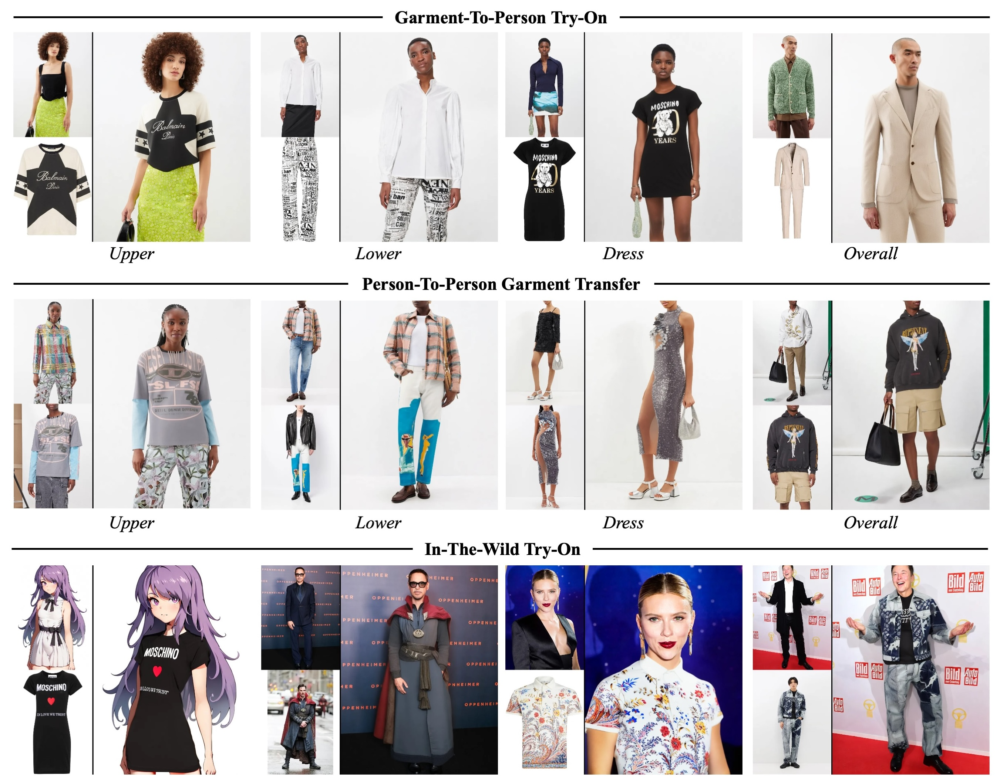
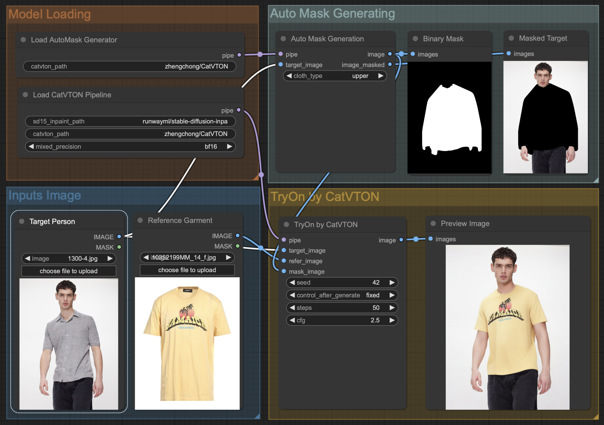
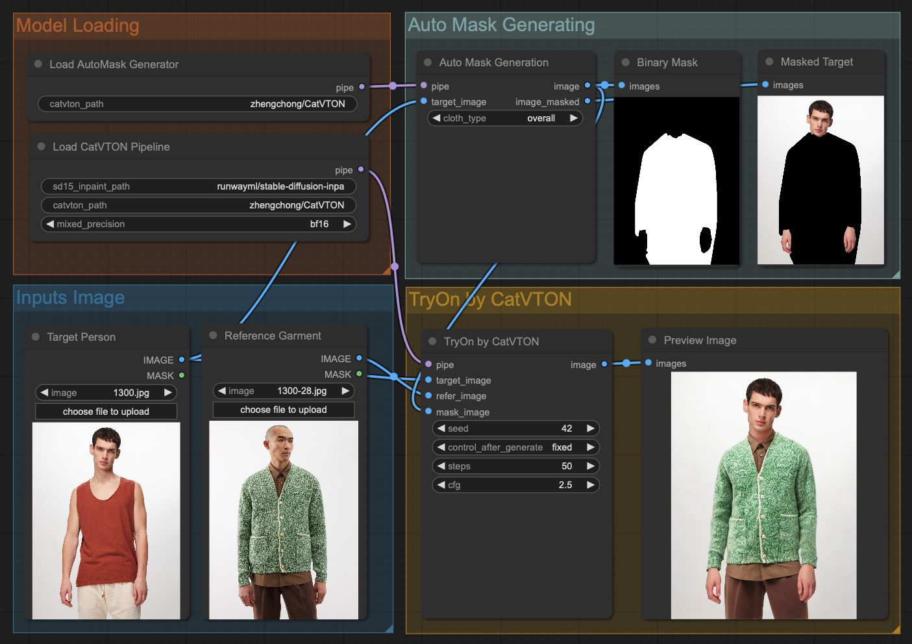

# [ICLR 25]🐈 CatVTON: Concatenation Is All You Need for Virtual Try-On with Diffusion Models

<div style="display: flex; justify-content: center; align-items: center;">
  <a href="http://arxiv.org/abs/2407.15886" style="margin: 0 2px;">
    
  </a>
  <a href='https://huggingface.co/zhengchong/CatVTON' style="margin: 0 2px;">
    
  </a>
  <a href="https://github.com/Zheng-Chong/CatVTON" style="margin: 0 2px;">
    
  </a>
  <a href="https://huggingface.co/spaces/zhengchong/CatVTON" style="margin: 0 2px;">
    
  </a>
  <a href="https://huggingface.co/spaces/zhengchong/CatVTON" style="margin: 0 2px;">
    
  </a>
  <a href='https://zheng-chong.github.io/CatVTON/' style="margin: 0 2px;">
    
  </a>
  <a href="https://github.com/Zheng-Chong/CatVTON/LICENCE" style="margin: 0 2px;">
    
  </a>
</div>


**CatVTON** is a simple and efficient virtual try-on diffusion model with ***1) Lightweight Network (899.06M parameters totally)***, ***2) Parameter-Efficient Training (49.57M parameters trainable)*** and ***3) Simplified Inference (< 8G VRAM for 1024X768 resolution)***.
<div align="center">
  
</div>


## Updates 
- **`2025/02/24`**: 🎉 We are excited to announce [**CatV2TON**](https://github.com/Zheng-Chong/CatV2TON), our new DiT-based model that supports both **image and video try-on**! Check it out!
- **`2025/02/20`**: Our [**Paper on ArXiv**](http://arxiv.org/abs/2407.15886) has been updated to v2, which includes more details.
- **`2025/01/24`**: 🥳 CatVTON has been accepted to **ICLR 2025**!
- **`2024/12/20`**: 😄 Code for gradio app of **CatVTON-FLUX** has been released! It is not a stable version, but it is a good start!
- **`2024/12/19`**: [**CatVTON-FLUX**](https://huggingface.co/spaces/zhengchong/CatVTON) has been released! It is a extremely lightweight LoRA (only 37.4M checkpints) for [FLUX.1-Fill-dev](https://huggingface.co/black-forest-labs/FLUX.1-Fill-dev), the lora weights are available in **[huggingface repo](https://huggingface.co/zhengchong/CatVTON/tree/main/flux-lora)**, code will be released soon!
- **`2024/11/26`**: Our **unified vision-based model for image and video try-on** will be released soon, bringing a brand-new virtual try-on experience! While our demo page will be temporarily taken offline, [**the demo on HuggingFace Space**](https://huggingface.co/spaces/zhengchong/CatVTON) will remain available for use !
- **`2024/10/17`**:[**Mask-free version**](https://huggingface.co/zhengchong/CatVTON-MaskFree)🤗 of CatVTON is release ! 
- **`2024/10/13`**: We have built a repo [**Awesome-Try-On-Models**](https://github.com/Zheng-Chong/Awesome-Try-On-Models) that focuses on image, video, and 3D-based try-on models published after 2023, aiming to provide insights into the latest technological trends. If you're interested, feel free to contribute or give it a 🌟 star!
- **`2024/08/13`**: We localize DensePose & SCHP to avoid certain environment issues.
- **`2024/08/10`**: Our 🤗 [**HuggingFace Space**](https://huggingface.co/spaces/zhengchong/CatVTON) is available now! Thanks for the grant from [**ZeroGPU**](https://huggingface.co/zero-gpu-explorers)！
- **`2024/08/09`**: [**Evaluation code**](https://github.com/Zheng-Chong/CatVTON?tab=readme-ov-file#3-calculate-metrics) is provided to calculate metrics 📚.
- **`2024/07/27`**: We provide code and workflow for deploying CatVTON on [**ComfyUI**](https://github.com/Zheng-Chong/CatVTON?tab=readme-ov-file#comfyui-workflow) 💥.
- **`2024/07/24`**: Our [**Paper on ArXiv**](http://arxiv.org/abs/2407.15886) is available 🥳!
- **`2024/07/22`**: Our [**App Code**](https://github.com/Zheng-Chong/CatVTON/blob/main/app.py) is released, deploy and enjoy CatVTON on your mechine 🎉!
- **`2024/07/21`**: Our [**Inference Code**](https://github.com/Zheng-Chong/CatVTON/blob/main/inference.py) and [**Weights** 🤗](https://huggingface.co/zhengchong/CatVTON) are released.
- **`2024/07/11`**: Our [**Online Demo**](https://huggingface.co/spaces/zhengchong/CatVTON) is released 😁.


## Installation

Create a conda environment & Install requirments
```shell
conda create -n catvton python==3.9.0
conda activate catvton
cd CatVTON-main  # or your path to CatVTON project dir
pip install -r requirements.txt
```

## Deployment 
### ComfyUI Workflow
We have modified the main code to enable easy deployment of CatVTON on [ComfyUI](https://github.com/comfyanonymous/ComfyUI). Due to the incompatibility of the code structure, we have released this part in the [Releases](https://github.com/Zheng-Chong/CatVTON/releases/tag/ComfyUI), which includes the code placed under `custom_nodes` of ComfyUI and our workflow JSON files.

To deploy CatVTON to your ComfyUI, follow these steps:
1. Install all the requirements for both CatVTON and ComfyUI, refer to [Installation Guide for CatVTON](https://github.com/Zheng-Chong/CatVTON/blob/main/INSTALL.md) and [Installation Guide for ComfyUI](https://github.com/comfyanonymous/ComfyUI?tab=readme-ov-file#installing).
2. Download [`ComfyUI-CatVTON.zip`](https://github.com/Zheng-Chong/CatVTON/releases/download/ComfyUI/ComfyUI-CatVTON.zip) and unzip it in the `custom_nodes` folder under your ComfyUI project (clone from [ComfyUI](https://github.com/comfyanonymous/ComfyUI)).
3. Run the ComfyUI.
4. Download [`catvton_workflow.json`](https://github.com/Zheng-Chong/CatVTON/releases/download/ComfyUI/catvton_workflow.json) and drag it into you ComfyUI webpage and enjoy 😆!

> Problems under Windows OS, please refer to [issue#8](https://github.com/Zheng-Chong/CatVTON/issues/8).
> 
When you run the CatVTON workflow for the first time, the weight files will be automatically downloaded, usually taking dozens of minutes.

<div align="center">
  
</div>

<!-- <div align="center">
 
</div> -->

### Gradio App

To deploy the Gradio App for CatVTON on your machine, run the following command, and checkpoints will be automatically downloaded from HuggingFace.

```PowerShell
CUDA_VISIBLE_DEVICES=0 python app.py \
--output_dir="resource/demo/output" \
--mixed_precision="bf16" \
--allow_tf32 
```
When using `bf16` precision, generating results with a resolution of `1024x768` only requires about `8G` VRAM.

## Inference
### 1. Data Preparation
Before inference, you need to download the [VITON-HD](https://github.com/shadow2496/VITON-HD) or [DressCode](https://github.com/aimagelab/dress-code) dataset.
Once the datasets are downloaded, the folder structures should look like these:
```
├── VITON-HD
|   ├── test_pairs_unpaired.txt
│   ├── test
|   |   ├── image
│   │   │   ├── [000006_00.jpg | 000008_00.jpg | ...]
│   │   ├── cloth
│   │   │   ├── [000006_00.jpg | 000008_00.jpg | ...]
│   │   ├── agnostic-mask
│   │   │   ├── [000006_00_mask.png | 000008_00.png | ...]
...
```

```
├── DressCode
|   ├── test_pairs_paired.txt
|   ├── test_pairs_unpaired.txt
│   ├── [dresses | lower_body | upper_body]
|   |   ├── test_pairs_paired.txt
|   |   ├── test_pairs_unpaired.txt
│   │   ├── images
│   │   │   ├── [013563_0.jpg | 013563_1.jpg | 013564_0.jpg | 013564_1.jpg | ...]
│   │   ├── agnostic_masks
│   │   │   ├── [013563_0.png| 013564_0.png | ...]
...
```
For the DressCode dataset, we provide script to preprocessed agnostic masks, run the following command:
```PowerShell
CUDA_VISIBLE_DEVICES=0 python preprocess_agnostic_mask.py \
--data_root_path <your_path_to_DressCode> 
```

### 2. Inference on VTIONHD/DressCode
To run the inference on the DressCode or VITON-HD dataset, run the following command, checkpoints will be automatically downloaded from HuggingFace.

```PowerShell
CUDA_VISIBLE_DEVICES=0 python inference.py \
--dataset [dresscode | vitonhd] \
--data_root_path <path> \
--output_dir <path> 
--dataloader_num_workers 8 \
--batch_size 8 \
--seed 555 \
--mixed_precision [no | fp16 | bf16] \
--allow_tf32 \
--repaint \
--eval_pair  
```
### 3. Calculate Metrics

After obtaining the inference results, calculate the metrics using the following command: 

```PowerShell
CUDA_VISIBLE_DEVICES=0 python eval.py \
--gt_folder <your_path_to_gt_image_folder> \
--pred_folder <your_path_to_predicted_image_folder> \
--paired \
--batch_size=16 \
--num_workers=16 
```

-  `--gt_folder` and `--pred_folder` should be folders that contain **only images**.
- To evaluate the results in a paired setting, use `--paired`; for an unpaired setting, simply omit it.
- `--batch_size` and `--num_workers` should be adjusted based on your machine.


## Acknowledgement
Our code is modified based on [Diffusers](https://github.com/huggingface/diffusers). We adopt [Stable Diffusion v1.5 inpainting](https://huggingface.co/runwayml/stable-diffusion-inpainting) as the base model. We use [SCHP](https://github.com/GoGoDuck912/Self-Correction-Human-Parsing/tree/master) and [DensePose](https://github.com/facebookresearch/DensePose) to automatically generate masks in our [Gradio](https://github.com/gradio-app/gradio) App and [ComfyUI](https://github.com/comfyanonymous/ComfyUI) workflow. Thanks to all the contributors!

## License
All the materials, including code, checkpoints, and demo, are made available under the [Creative Commons BY-NC-SA 4.0](https://creativecommons.org/licenses/by-nc-sa/4.0/) license. You are free to copy, redistribute, remix, transform, and build upon the project for non-commercial purposes, as long as you give appropriate credit and distribute your contributions under the same license.


## Citation

```bibtex
@misc{chong2024catvtonconcatenationneedvirtual,
 title={CatVTON: Concatenation Is All You Need for Virtual Try-On with Diffusion Models}, 
 author={Zheng Chong and Xiao Dong and Haoxiang Li and Shiyue Zhang and Wenqing Zhang and Xujie Zhang and Hanqing Zhao and Xiaodan Liang},
 year={2024},
 eprint={2407.15886},
 archivePrefix={arXiv},
 primaryClass={cs.CV},
 url={https://arxiv.org/abs/2407.15886}, 
}
```

# CatVTON 검증
 
가상 피팅(의류 시착) 기능의 메인 모델로 CatVTON을 검증하고, 빈티지 의류 특성(핏 다양성)
반영을 위해 마스킹 로직을 확장한 코드입니다.
 
## 개요
 
CatVTON(diffusion 기반 inpainting형 virtual try-on 모델)을 기반으로, 오버사이즈/크롭 등
의류 핏(fit) 차이를 시각화하는 기능을 자체적으로 추가했습니다. FLUX.2 klein 대비 속도와
레퍼런스 반영 정확도 모두 우수하여 메인 파이프라인으로 채택했습니다.
 
## 파일 설명
 
| 파일 | 설명 |
|---|---|
| `model/cloth_masker.py` | **원본 CatVTON 코드에서 수정됨.** `AutoMasker`에 `fit_type` 파라미터(`regular`/`oversized`/`cropped`) 추가. DensePose 신체 부위 정보를 이용해 마스크를 확장(oversized)/축소(cropped)하는 `adjust_mask_for_fit()` 함수 신규 구현 |
| `test_mask.py` | 마스크 생성 결과만 시각화하는 스크립트 (`vis_mask`로 핏별 마스크 차이 확인용) |
| `test_fit_tryon.py` | person+cloth 이미지로 핏별(regular/oversized/cropped) 착장 이미지를 실제 생성하는 스크립트. `composite_with_original()`로 마스크 바깥 영역(얼굴/포즈/배경)을 원본 픽셀로 되돌려 미세 변형 방지 |
| `benchmark_catvton_base.py` | 기본 CatVTON 파이프라인 성능 측정 스크립트. `fit_type="regular"`로 고정하여 원본과 동일한 동작 기준으로 측정 |
| `catvton_benchmark_base_results.json` | 벤치마크 결과 원본 (RTX 4050 6GB 기준) |
| `requirements_catvton.txt` | `pip freeze` 결과. 설치 순서 주의 필요 (아래 참고) |
 
## 환경 설정
 
```bash
conda create -n catvton python=3.10 -y
conda activate catvton
 
# torch는 반드시 CUDA 빌드 + 2.4.1 이상으로 명시 설치
# (2.4.0은 Windows에서 fbgemm.dll 로딩 실패 버그 있음, PyTorch 이슈 #131662)
pip install torch==2.4.1 torchvision==0.19.1 --index-url https://download.pytorch.org/whl/cu121
 
pip install -r requirements_catvton.txt
```
 
버전이 서로 얽혀 있어 설치 후 아래 조합이 맞는지 반드시 확인할 것:
 
```
diffusers==0.30.0
huggingface_hub==0.26.2
gradio==4.44.1
accelerate==0.34.2
starlette<1.0
fastapi<0.135
pydantic==2.10.6
```
 
(gradio 최신판은 `huggingface_hub>=1.0`을 요구해 `transformers`/`tokenizers`의
`huggingface_hub<1.0` 요구사항과 충돌하므로 위 조합으로 고정 필요.)
 
## 실행 방법
 
`image/person.jpg`, `image/cloth.jpg` 준비 후:
 
```bash
python test_mask.py          # 마스크만 먼저 시각화 확인
python test_fit_tryon.py     # 실제 착장 이미지 생성 (regular/oversized/cropped)
python benchmark_catvton_base.py  # 성능 측정
```
 
## 검증 결과 요약
 
- **성능**: step당 약 2.1초 (RTX 4050 6GB 기준). FLUX.2 klein 대비 약 4~5배 빠름.
  자세한 수치는 `catvton_benchmark_base_results.json` 참고.
- **핏 조정 기능**: DensePose 기반 신체 부위(forearm, torso 등) 마스크를 규칙 기반으로
  확장/축소하여 oversized/cropped 핏을 표현. 마스크 단계에서 얼굴/손/발은
  `strong_protect_area`로 항상 보호되므로 구조적으로 인물 정체성 보존이 가능.
- **한계**: 
  - 마스크 조정 강도(dilate kernel 크기, cutoff 비율)는 초기 실험값이며 추가 튜닝 필요
  - oversized 설정에서 마스크 경계 처리가 거칠 경우 NSFW 세이프티 체커 오탐(false positive)
    발생 가능 (실제 부적절한 콘텐츠가 아닌 생성 결함으로 인한 오탐으로 판단)
  - 체형 차이로 인한 물리적으로 정확한 구김/접힘 표현은 diffusion 기반 접근의 구조적
    한계로, 현재는 근사적 시각화 수준
## 참고
 
- 본 벤치마크는 CatVTON의 **기본 파이프라인**(`fit_type="regular"`) 기준으로 측정됨.
  `model/cloth_masker.py`는 핏 조정 기능을 위해 자체 확장되었으나, `regular` 모드는
  원본 CatVTON과 동일한 동작을 재현하도록 설계됨.
- 모델 로딩(13.79초)과 마스크 생성(2.88초)은 1회성/전처리 비용으로, steps별 추론 시간과는
  별도로 측정됨.
- 512×512와 768×1024에서 추론 시간이 거의 동일하게 측정되어(각각 77.14초, 76.28초),
  해상도보다 고정 오버헤드가 지배적인 요인일 가능성이 있음. 추가 해상도 구간에서의
  검증이 필요함.
- Peak VRAM은 steps/해상도와 무관하게 4.89GB로 일정하게 측정됨.
- 가중치(DensePose, SCHP, CatVTON attention ckpt)는 최초 실행 시 Hugging Face에서
  자동 다운로드됨 (`zhengchong/CatVTON` 리포).
- CatVTON은 CC BY-NC-SA 라이선스(비상업적 사용)로 배포됨. 캡스톤(학술 프로젝트) 용도로는
  문제없으나 상용 서비스 전환 시 라이선스 재검토 필요.