# 실제 판매 사진 3장으로 본 실측 파이프라인 — 결과 정리

합성 이미지(회색 배경 위에 흰 A4 사각형을 합성)로만 검증했던 걸 실제 판매 사진 3장으로
넓혔다. 사진이 하나씩 늘어날 때마다 진짜 버그 3개를 찾아 고쳤고, 고칠 수 없는(고치면
오히려 더 위험해지는) 근본 한계 하나도 확인했다 — 아래 순서대로 정리한다.

재현 스크립트: [verify_real_photo.py](verify_real_photo.py)(사진 1),
[verify_real_photo2.py](verify_real_photo2.py)(사진 2),
[verify_real_photo3.py](verify_real_photo3.py)(사진 3) — 전부 프로덕션 클래스
(`OpenCVContourReferenceDetector`, `GrabCutGarmentSegmenter`, `HRNetLandmarkDetector`)를
그대로 가져와 돌린다.

## 발견해서 고친 버그 2개

### 1. iPhone 사진의 EXIF 방향 태그를 무시하던 문제

사진 3(`valid_image3.jpg`)이 아이폰 12 Pro로 찍은 원본이었는데, EXIF `Orientation=6`
(뷰어가 90도 돌려서 보여줘야 하는 상태)이 찍혀 있었다. 그런데
`worker/models/garment_measurement/image_io.py`의 `load_image()`는 PIL로 읽기만 하고 이
태그를 반영하지 않아서, 픽셀 데이터가 옆으로 누운 채로 파이프라인에 들어가고 있었다.
판매자 대부분이 폰으로 촬영할 텐데 이러면 랜드마크 좌표가 사람이 보는(화면에 표시되는)
방향과 어긋난다 — `ImageOps.exif_transpose()` 호출을 추가해 고쳤다. 회귀 테스트:
[test_image_io.py](../../test/worker/garment_measurement/test_image_io.py).

### 2. 기준 물체 후보에 최소 면적 기준이 없던 문제

사진 2(`valid_image2.jpg`)에서, 진짜 스프링노트는 컨투어 4각형으로 아예 안 잡혔는데
원단 주름이 우연히 만든 손톱만 한 4각형(면적 31px², 전체 프레임의 0.006%)이 A4 비율(1:1.414)
근처(1.24)를 통과해 "그나마 비율 맞는 후보 중 제일 큼"으로 채택돼 버렸다. 그 결과
`pixel_to_cm_ratio`가 4.5cm/px로 나왔고(정상 범위의 수십 배), 이걸로 환산한 어깨너비가
1385.7cm로 나왔다 — **사용자가 처음에 짐작한 "측정 오류"가 정확히 이 형태로 재현됐다.**

`OpenCVContourReferenceDetector`에 `_MIN_AREA_RATIO`(프레임 대비 최소 면적 비율, 1%)를
추가해 손톱만 한 후보는 애초에 후보에서 제외했다. 이제는 진짜 기준 물체를 못 찾으면
조용히 틀린 값을 내는 대신 `found=False`로 정직하게 실패한다(재촬영 유도로 이어짐).
회귀 테스트: [test_reference_detector.py](../../test/worker/garment_measurement/test_reference_detector.py)의
`test_tiny_a4_shaped_noise_is_ignored_in_favor_of_no_match`.

### 3. TOTAL_LENGTH(총장)를 목선 기준으로 재던 문제

수동 계산으로 사진3 사이즈를 뽑아 보여드렸을 때 발견됐다. `cm_converter.py`가 총장을
`거리(NECKLINE_CENTER, HEM_CENTER)`로 계산하고 있었는데, NECKLINE_CENTER는 칼라가 파인
정면 목선 중앙이라 옷의 실제 최고점(어깨 끝)보다 낮다 — 즉 총장이 실제보다 짧게
나오고 있었다. 사진3 기준 어깨 y좌표(1077~1121)가 목선 y좌표(1231)보다 110~150px
높았다(=카메라 좌표에서 더 위쪽). 옷 사이즈 표기 관례대로 `거리(SHOULDER, HEM_CENTER)`
좌우 평균으로 바꿨다 — 사진3 기준 총장이 55.3cm → **63.0cm**로 바뀌었다(7.7cm 차이,
무시할 수 없는 크기). 회귀 테스트:
[test_cm_converter.py](../../test/worker/garment_measurement/test_cm_converter.py)의
`test_total_length_uses_shoulder_to_hem_center_not_neckline`.

## 사진별 결과

### 사진 1 — 자켓 + 메모지 (`valid_image.jpg`)

카테고리가 검증된 3종(반팔 상의/바지/긴팔 원피스) 밖이라 랜드마크 검출은 스킵, 기준 물체
검출/원단 분할만 테스트했다.

| 단계 | 결과 |
| --- | --- |
| 기준 물체 검출 | **찾음** (`ratio→cm 0.1022`) — 메모지가 A4 비율(1.495, 편차 5.7%)로 정확히 잡힘 |
| 원단 분할 | 부분 성공 — 소매 잘림, 메모지가 옷과 한 덩어리 bbox로 잡힘 |

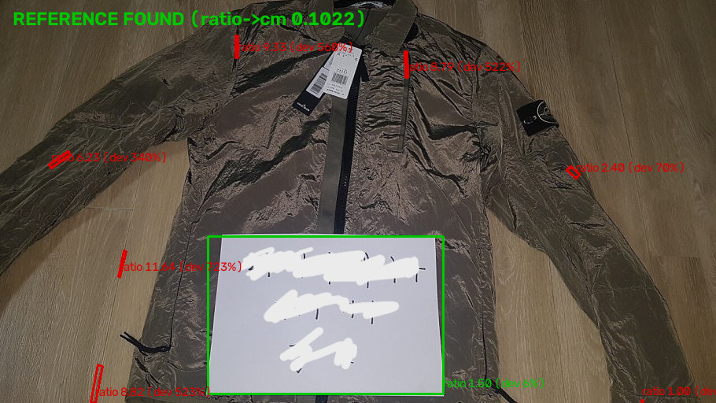
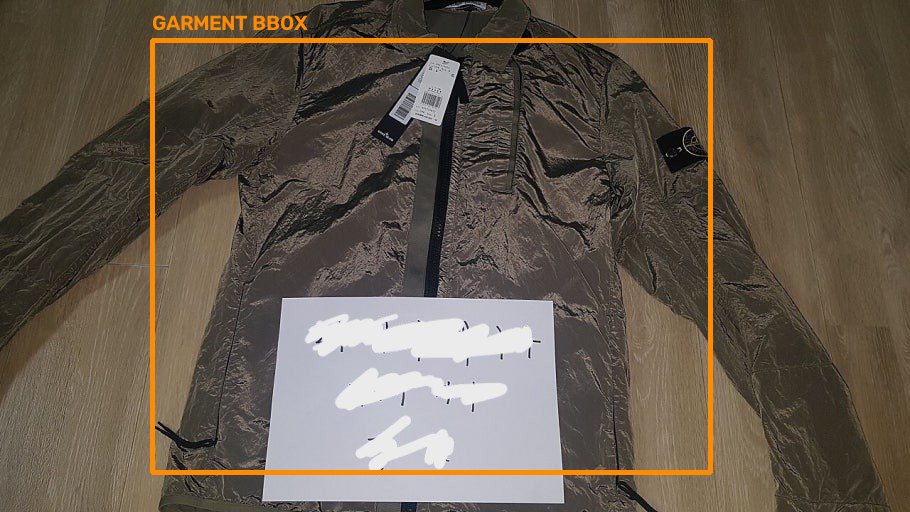

### 사진 2 — 반팔 상의 + 스프링노트 (`valid_image2.jpg`)

카테고리가 SHORT_SLEEVE_TOP(검증됨)이라 전체 4단계를 다 테스트했다.

| 단계 | 결과 |
| --- | --- |
| 기준 물체 검출 | **못 찾음** (버그 수정 후) — 노트가 크림색 vs 흰 티셔츠라 대비가 약해 4각형 자체가 안 잡힘 |
| 원단 분할 | 성공 — 나무 바닥 배경 덕에 대비가 충분해서 bbox가 셔츠 모양대로 잘 잡힘 |
| 랜드마크 검출 | 성공 — 8개 지점 모두 검출, 목선/어깨/밑단 신뢰도 0.79~0.87로 양호. 소매 끝만 낮음(0.24, 0.35) |
| cm 환산 | **불가** — 기준 물체를 못 찾아 `pixel_to_cm_ratio`가 없음(measurements 빈 배열) |

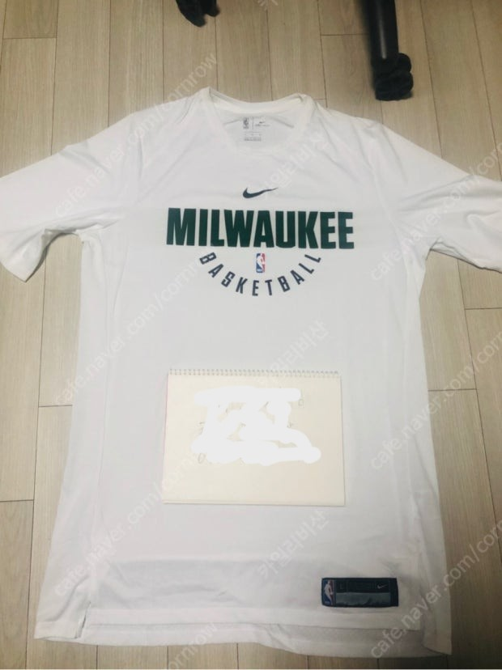
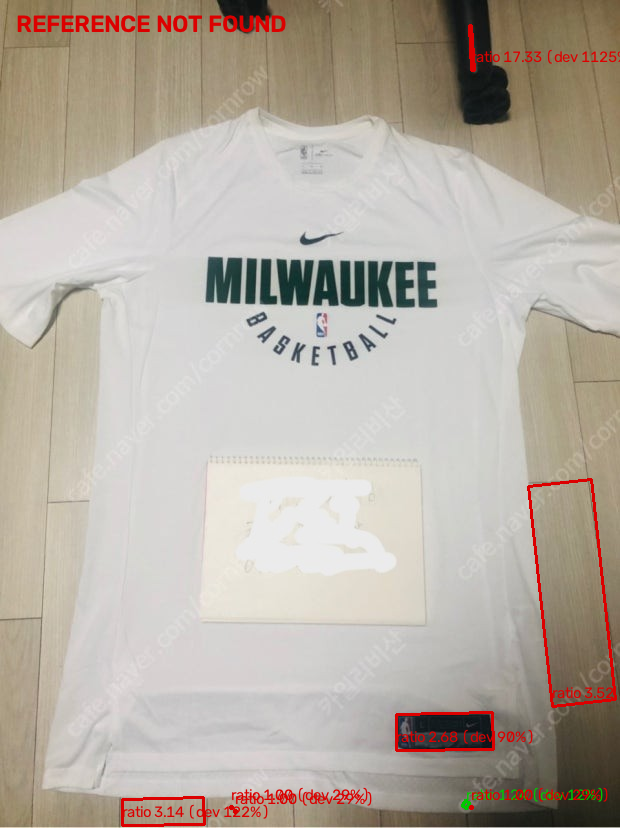
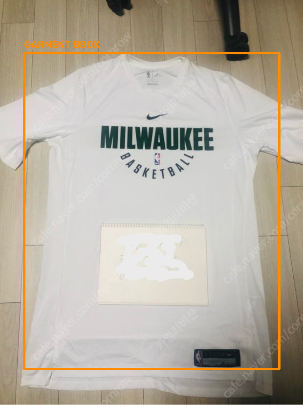
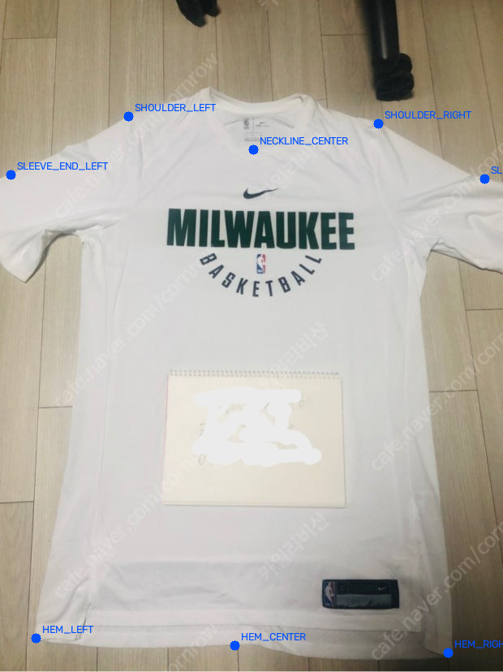

### 사진 3 — 반팔 상의(Deus Ex Machina) + 실제 A4 프린트물 (`valid_image3.jpg`)

아이폰으로 찍은 실제 A4 용지(표가 인쇄된 종이) 사진. EXIF 회전 버그를 여기서 발견해 고쳤다
(위 참고). 카테고리는 SHORT_SLEEVE_TOP.

| 단계 | 결과 |
| --- | --- |
| 기준 물체 검출 | **못 찾음** — A4 바깥 테두리 자체가 Canny 엣지맵에 거의 안 잡힘(흰 종이 vs 크림색 티셔츠, 대비 부족). 안쪽 인쇄된 표 선만 잡혀서, 최선의 후보도 A4 비율에서 51% 벗어나 탈락 |
| 원단 분할 | "성공"이지만 사실상 무의미 — 배경(흰 책상)도 셔츠와 비슷하게 밝아서 bbox가 프레임 전체에 가깝게 잡힘 |
| 랜드마크 검출 | 부분 성공 — bbox가 프레임 전체였는데도 어깨/목선/소매 지점은 정확했다. 다만 밑단 3개(HEM_LEFT/CENTER/RIGHT)는 신뢰도가 낮았고(0.37~0.53), 실제로 진짜 밑단 시접선보다 안쪽(옷 몸통 쪽)에 찍혀 있었다 — 아래 "밑단 랜드마크 오차" 참고 |
| cm 환산 | **불가** — 기준 물체를 못 찾아 `pixel_to_cm_ratio` 없음 |

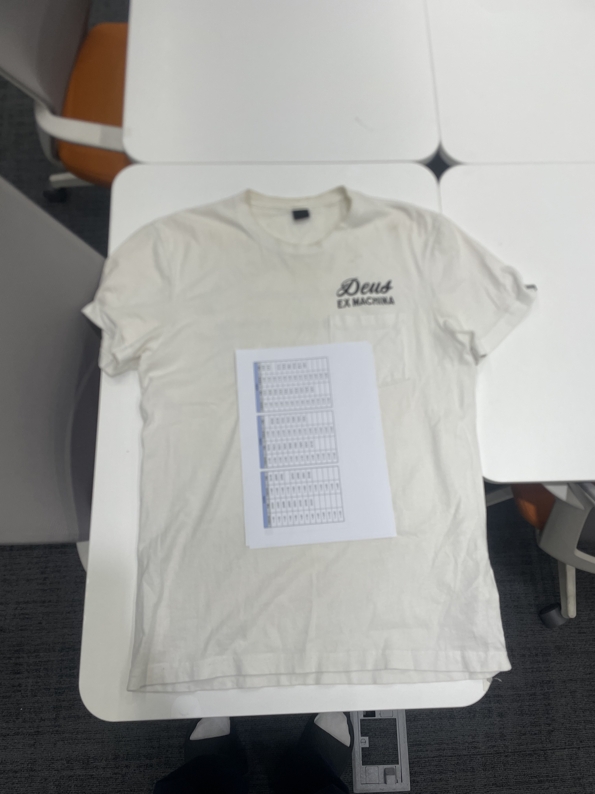
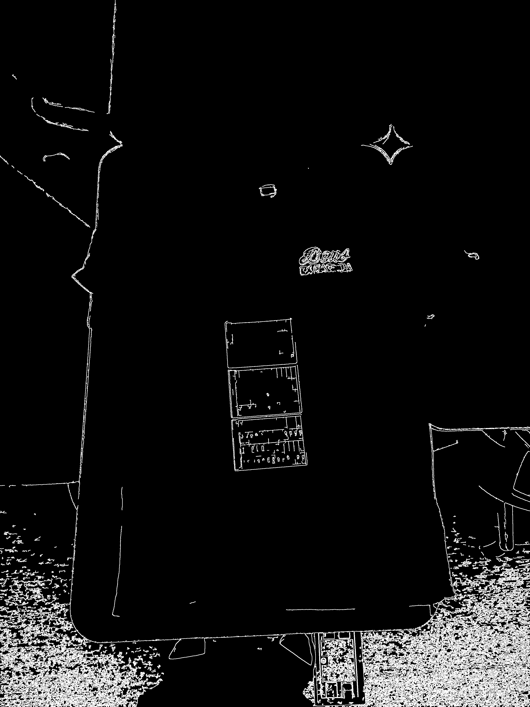
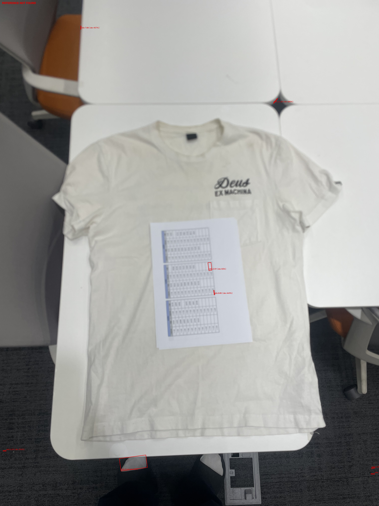
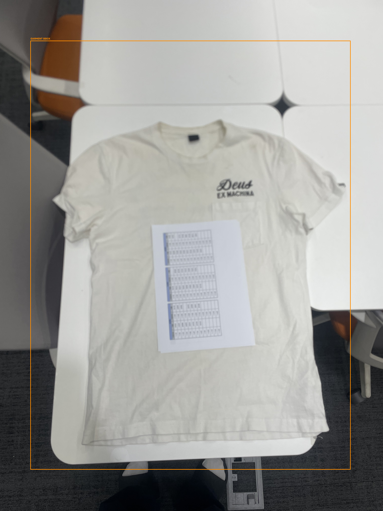

### 밑단 랜드마크 오차 (사진 3)

밑단 부분을 확대해서 보면, HEM_LEFT/CENTER/RIGHT 세 점 모두 실제 시접선(사진에 보이는
바느질 선)보다 위쪽, 옷 몸통 안쪽에 찍혀 있다 — 세 점 다 신뢰도가 가장 낮았던
지점들(0.37~0.53, 어깨/목선은 0.8대)과 정확히 일치한다. 즉 **이 모델의 신뢰도 점수가
실제 정확도와 어느 정도 상관관계가 있다**는 뜻이기도 하다(낮은 신뢰도 = 실제로 부정확).
이 사진에서만 나타난 문제인지, 밑단 검출이 전반적으로 약한 편인지는 사진이 더 있어야
판단할 수 있다.

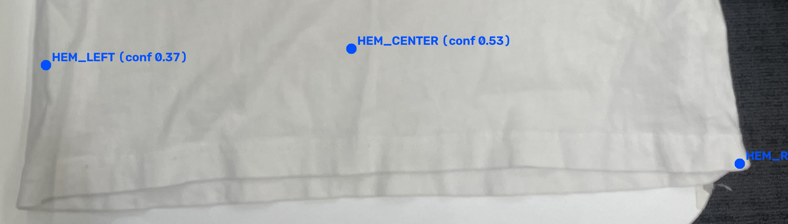

**Canny 임계값을 더 낮추면 복구될까 시험해봤다.** (5, 25)까지 낮추니 A4 비율에 4% 오차로
맞는 큰 후보(22만px²)가 나오긴 했다 — 그런데 실제로는 A4 테두리가 아니라 **인쇄된 표 안의
칸 두 개를 하나로 묶은 영역**이었다(그림으로 확인). 즉 임계값을 낮추는 건 "못 찾음"을
"확신에 찬 오답"으로 바꾸는 것과 같았다 — 지금처럼 못 찾고 정직하게 실패하는 쪽이 훨씬
안전해서 이 튜닝은 적용하지 않았다.

## 대비 강화 기법 2가지를 더 시험해봤다 (사진 2·3만)

병목이 "색상 대비 부족"이라는 게 명확해진 뒤, 대비를 강제로 끌어올리는 기법이 도움이
될지 사진 2·3에 한해 추가로 시험했다. 결론부터: **둘 다 문제를 해결하지 못했고, 오히려
더 그럴듯한 오답을 만들어냈다.**

**CLAHE(적응형 히스토그램 평활화)** — 그레이스케일 명암을 국소적으로 늘리는 기법. 사진3
중앙 200×200 패치의 표준편차가 6.9 → 22.5로 3배 이상 뛸 만큼 국소 대비 자체는 확실히
커졌다. 그런데 Canny를 다시 돌려보니(임계값 30,90) A4 비율과 **편차 0.78%**(지금까지
중 가장 정밀하게 일치)인 큰 후보가 나왔다 — 확인해보니 이번에도 진짜 테두리가 아니라
인쇄된 표의 맨 아래 칸이었다. 이유: 표 안의 검은 인쇄선(원래도 대비가 컸던 경계)이
CLAHE로 더 강조된 반면, 종이-옷 경계(원래 대비가 거의 없던 경계)는 없던 신호를 만들어낼
수 없었다. 사진2에서는 부작용까지 있었다 — 프레임 전체 크기(51만px², 전체의 87%)가
A4 비율 후보로 잡히는 새로운 오탐이 나왔다.

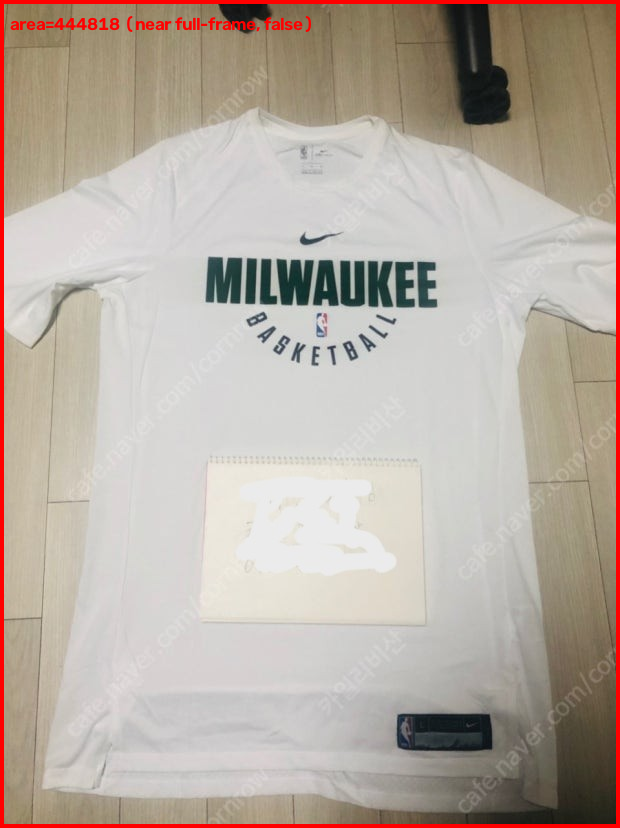

**바깥쪽 컨투어만 보기(`cv2.RETR_EXTERNAL`)** — "진짜 테두리가 안쪽 표 때문에 가려진
것 아닐까?" 하는 가설로 시험했다. 결과는 동일 후보(인쇄된 표 칸)가 그대로 다시 나왔다 —
즉 계층 구조 문제가 아니라, **애초에 종이 바깥 테두리가 엣지맵에 닫힌 윤곽선으로
존재하지 않는다**(대비가 너무 약해서 Canny가 선 자체를 못 그린다)는 뜻이다. 이건 컨투어
검색 전략을 바꾼다고 고쳐지지 않는다.

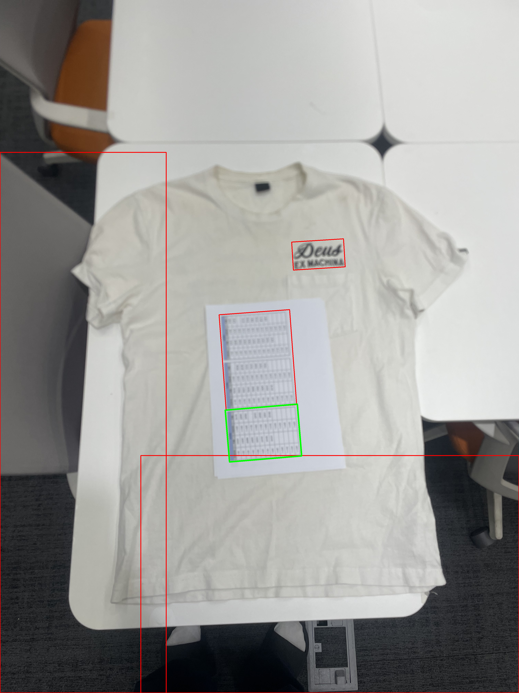

## 옷 사이즈 — 사진 3 기준, 수동으로 A4 위치를 잡아 계산

자동 검출이 안 돼도 최종적으로 알고 싶은 건 옷 사이즈이므로, 사진 3(진짜 규격 A4 용지가
있는 사진)에 한해 **A4 네 모서리를 육안으로 직접 짚어서** 기준 비율을 계산했다. 자동
파이프라인이 낸 값이 아니라 이번 리포트를 위한 수동 보정값이라는 점을 분명히 해둔다.

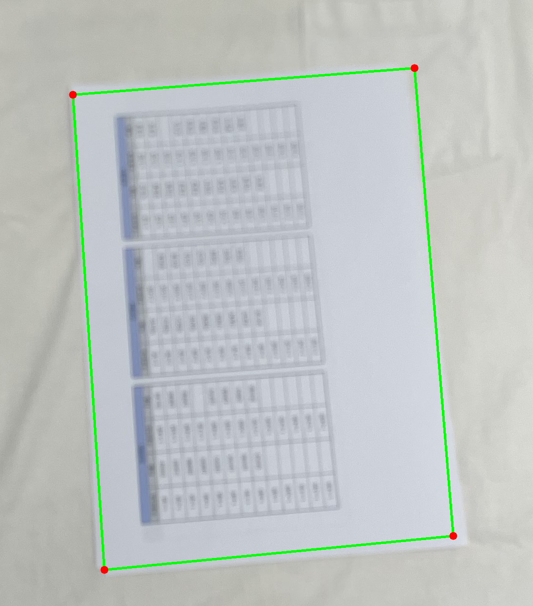

네 모서리(원본 픽셀 좌표): `(1200,1795) (1905,1740) (1985,2705) (1265,2775)`.
짧은 변 평균 715.3px, 긴 변 평균 975.2px(비율 1.363 — A4 1.414와 3.5% 차이, 사진이
완전한 수직 촬영이 아니라 원근 왜곡이 약간 섞인 탓으로 보인다). 여기서 나온
`pixel_to_cm_ratio = 0.02991cm/px`를 앞서 검출된 랜드마크 8개에 그대로 적용했다
(`cm_converter.convert()` 재사용, 로직은 프로덕션과 동일).

| 측정 항목 | 값 | 신뢰도 |
| --- | --- | --- |
| SHOULDER_WIDTH(어깨너비) | **42.8 cm** | 0.80 |
| SLEEVE_LENGTH(소매길이, 좌우 평균) | **18.5 cm** | 0.80 |
| TOTAL_LENGTH(총장, 어깨 기준으로 수정 후) | **63.0 cm** | 0.53 |
| HEM_WIDTH(밑단너비) | **55.9 cm** | 0.37 |

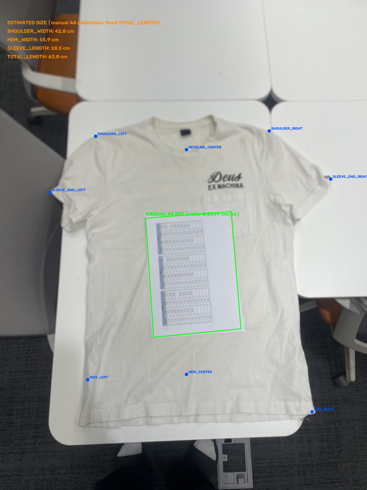

**주의할 점**: 이 수치는 "파이프라인이 잘 동작하면 이 정도 값이 나온다"는 걸 보여주는
수동 보정 결과이지, 자동화된 결과가 아니다.
- 모서리를 눈으로 짚은 오차(대략 ±1~2%), 사진이 완전 수직이 아니라서 생기는 원근 왜곡
  (모서리 지점이 카메라에서 먼 쪽/가까운 쪽에 따라 스케일이 약간 다를 수 있음)이 안
  보정돼 있다.
- TOTAL_LENGTH/HEM_WIDTH는 밑단 랜드마크(HEM_LEFT/CENTER/RIGHT) 신뢰도 자체가
  낮았고(0.37~0.53), 위에서 확인했듯 실제 시접선보다 안쪽에 찍혀 있었다 — 그만큼 두 값
  모두 **실제보다 짧게** 나왔을 가능성이 있다(총장은 목선→어깨 기준 수정으로 이미 한 번
  보정됐지만, 밑단 포인트 자체의 안쪽 치우침은 아직 안 고쳐진 상태). 그래서 표의 이
  두 값은 특히 참고용으로만 보는 게 좋다.

사진 2(스프링노트)는 노트의 실제 규격을 몰라서 같은 방식을 적용할 수 없다 — 노트 실측
치수를 알려주시면 같은 방법으로 사이즈를 뽑아볼 수 있다.

## 종합

세 사진 모두에서 반복되는 패턴 하나: **기준 물체 검출과 원단 분할 둘 다 "색이 서로
충분히 달라야 경계를 찾는다"는 같은 약점을 공유한다.** 사진 1(짙은 자켓 위 흰 종이)처럼
대비가 뚜렷하면 둘 다 잘 되고, 사진 2·3처럼 종이·옷·배경이 전부 흰색/크림색 계열로
몰리면 기준 물체 검출부터 막힌다. 반면 **랜드마크 검출(HRNet)은 이 문제와 거의 무관하게
잘 동작했다** — bbox가 부정확해도(사진 3처럼 프레임 전체를 줘도) 어깨/소매/밑단 지점
자체는 육안으로도 정확했다.

즉 지금 병목은 랜드마크 모델이 아니라 **앞단 두 단계(기준 물체 검출·원단 분할)의 색상
대비 의존성**이다. 이번에 고친 두 버그(EXIF 방향, 최소 면적 필터)는 "틀린 값을 조용히
내보내는" 실패를 막아주지만, "애초에 흰 종이를 흰 옷 위에서 못 찾는" 근본 문제 자체는
남아 있다 — Canny 임계값(단순 완화, CLAHE 대비 강화, RETR_EXTERNAL 계층 필터링) 세 가지를
다 시험해봤지만 셋 다 못 고쳤고, 뒤의 둘은 오히려 더 그럴듯한 오답을 만들었다는 것도 이번에
확인했다. 다음에 고려해볼 만한 방향(코드로 바로 옮기지 않고 열어만 둠):

- 기준 물체 자체를 더 잘 구분되게 만들기(예: 테두리에 굵은 색선을 인쇄한 전용 실측 용지) —
  A4 규격은 유지하되 색만 바꾸는 절충안
- 순수 Canny+컨투어 대신, 그림자/미세한 두께 차이 같은 다른 단서를 쓰는 검출 방식
- 이 한계를 촬영 가이드에 반영: "흰 옷이면 종이를 옷 위가 아니라 옷과 대비되는 바닥/배경
  쪽에 걸치듯 놓아 달라" 같은 안내(다만 사용자가 지적했듯 실제로는 대부분 옷 위에 그냥
  올려 찍을 가능성이 높아, 안내만으로는 완전히 해결되지 않을 수 있음)
