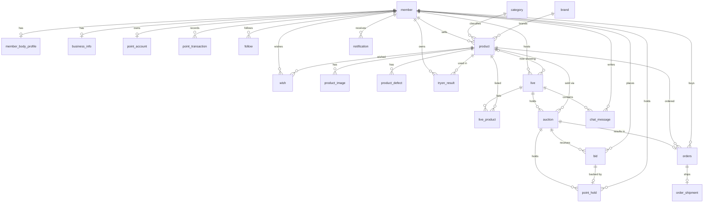
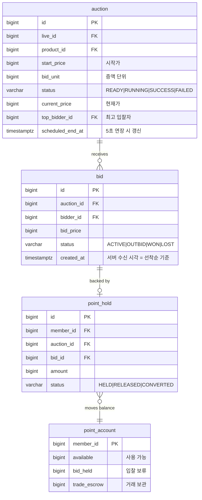
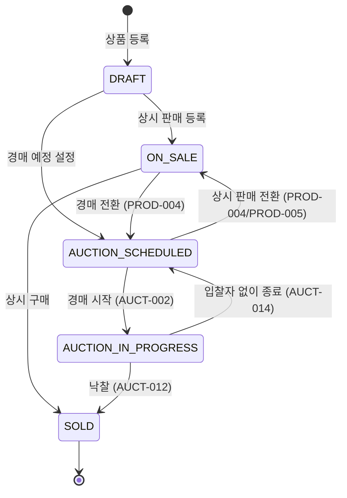

# ERD 및 상태 설계 (S15P11A108-296)

> 대상 DB: PostgreSQL 18 · 테이블 25개
> DDL: [`schema.sql`](./schema.sql) — 실제 PostgreSQL 18에 적용 검증 완료
> 데이터 사전: [`data-dictionary.md`](./data-dictionary.md) — 이 스키마에서 자동 생성
>
> 아래 다이어그램은 mermaid 원본이다. GitLab·Notion은 그대로 렌더링하지만,
> mermaid를 못 쓰는 곳(발표자료 등)을 위해 [`img/`](./img)에 SVG·PNG를 함께 둔다.
> 이미지는 파생물이므로 직접 고치지 말고 `bash BE/docs/db/export-erd.sh`로 다시 뽑는다.

## 0. 이 문서를 읽는 사람에게

전 도메인이 하나의 스키마 위에 올라간다. **각자 그린 뒤 합치면 FK가 어긋나므로 이 문서를 단일 기준으로 삼는다.**

담당 경계는 아래와 같으나 스키마 자체는 공유한다.

| 담당 | 테이블 |
| --- | --- |
| **서윤** | `member*`, `business_info`, `brand`, `category`, `product*`, `tryon_result`, `wish`, `follow`, `point_*`, `orders`, `order_shipment`, `notification` |
| **정윤** | `live`, `live_product`, `auction`, `bid`, `chat_message` |

---

## 1. 전체 ERD

[이미지로 보기](./img/erd-full.png)

## 2. 핵심 관계 — 입찰 1건이 건드리는 것

[이미지로 보기](./img/erd-bid-core.png)

경매 로직의 중심이다. 입찰 한 번에 `bid` 생성 → 이전 `point_hold` 해제 → 새 `point_hold` 생성 → `auction` 현재가·최고입찰자 갱신이 **하나의 트랜잭션 안에서** 일어난다.

---

## 3. 상태 enum 확정

### 3-1. 상품 판매 상태 `product.sale_status`

[이미지로 보기](./img/product-status.png)

| 값 | 의미 |
| --- | --- |
| `DRAFT` | 등록 중(미공개) |
| `ON_SALE` | 상시 판매 중 |
| `AUCTION_SCHEDULED` | 경매 예정 — 가격 없음, 홈에서 '경매 예정'으로 표시. 입찰자 없이 경매가 끝나도 다시 이 상태로 남는다 |
| `AUCTION_IN_PROGRESS` | 경매 진행 중 — 상시 구매 즉시 중단 (LIVE-006) |
| `SOLD` | 판매 완료(낙찰 포함) |

> **`AUCTION_FAILED`라는 별도 상태를 두지 않는 이유.** 입찰자 없이 경매가 끝나도 상품은 그냥
> `AUCTION_SCHEDULED`로 돌아간다(경매 도메인이 실패 시 `product`를 건드릴 필요가 없어짐). 판매자는
> 이 상태의 상품을 아무 때나 골라 가격을 넣고 `ON_SALE`로 전환하거나(PROD-005), 그냥 둬서 다음
> 라이브에서 다시 경매되게 할 수 있다 — "그대로 둔다"는 선택은 아무 것도 안 하면 되므로 API도
> 필요 없다. 이 상품이 예전에 실패한 적이 있다는 이력은 `product.sale_status`에는 안 남지만
> `auction` 테이블에 그 시도가 `status='FAILED'`인 row로 남아 있어 사라지지 않는다.
>
> **`PRIVATE`는 없앴다.** 처음엔 미낙찰 후속 선택지에 "비공개"도 있었지만 기획에서 빠졌다. 이
> 상태로 들어오는 화살표가 이거 하나뿐이었어서, 선택지가 없어지면 `PRIVATE`는 영원히 도달 불가능한
> 죽은 상태가 된다. 그래서 enum·CHECK 제약에서 완전히 제거했다.

### 3-2. 방송 상태 `live.status`

| 값 | 의미 |
| --- | --- |
| `SCHEDULED` | 예정 (LIVE-001 예약 개설) |
| `LIVE` | 진행 중 (LIVE-002 즉시 개설 시 바로 이 상태) |
| `ENDED` | 종료 |
| `CANCELED` | 방송 전 취소 |

### 3-3. 경매 상태 `auction.status`

| 값 | 의미 |
| --- | --- |
| `READY` | 조건 설정 완료, 시작 전 (AUCT-001) |
| `RUNNING` | 진행 중 (AUCT-002) |
| `SUCCESS` | 낙찰 (AUCT-012) |
| `FAILED` | 입찰자 없이 종료 (AUCT-014) |
| `CANCELED` | 취소 |

### 3-4. 포인트 상태 — 6종

기능정의서 §4.9의 6종을 **잔액 버킷(`point_account`의 컬럼)** 으로 구현했다. 별도 상태 컬럼을 두지 않고 금액이 버킷 사이를 이동한다.

| 상태 | 컬럼 | 이동 계기 |
| --- | --- | --- |
| 사용 가능 | `available` | 충전, 보류 해제, 환불 |
| 입찰 보류 | `bid_held` | 최고 입찰자가 됨 (AUCT-007) |
| 거래 보관 | `trade_escrow` | 낙찰·구매 확정 전 |
| 판매자 정산 | `settling` | 구매 확정 후 판매자 몫 |
| 환불 | — | `available`로 되돌아감 + `point_transaction.type='REFUND'` 기록 |
| 출금 처리 | `withdrawing` | 출금 요청 |

> **왜 상태 컬럼이 아니라 잔액 버킷인가.** 포인트는 "1건이 하나의 상태를 갖는" 것이 아니라 "총액이 여러 주머니에 나뉘어 있는" 성격이다. 입찰 보류는 *금액*을 묶는 것이지 특정 충전 건을 묶는 게 아니다. 버킷 방식이면 잔액 조회가 단순 SELECT 한 번이고, 보류/해제가 두 컬럼 간 이동이라 원자성을 보장하기 쉽다. 이동 이력은 `point_transaction` 원장에 append-only로 남는다.

### 3-5. 주문 상태 `orders.status`

`PAID` → `SHIPPING` → `DELIVERED` → `CONFIRMED` → `SETTLED` (+ `REFUNDED` / `CANCELED`)

로드맵 부록의 판매 흐름(낙찰 → 대금 보관 → 송장 등록 → 배송 완료 → 구매 확정 → 정산)을 그대로 옮긴 것이다.

> **`auto_confirm_at` 컬럼을 둔 이유.** "구매 확정 또는 **자동 구매 확정(3일)**"이 정책이다. 스케줄러가 매번 `delivered_at + 3일`을 계산하며 전체를 스캔하면 주문이 쌓일수록 느려진다. 배송 완료 시점에 확정 예정 시각을 미리 박아두고 `WHERE status='DELIVERED'` 부분 인덱스로 좁힌다.

---

## 4. 정책을 DB 제약으로 못 박은 것

애플리케이션 검증만으로는 동시성 상황에서 뚫린다. **아래 정책들은 DB 레벨에서 막았고, 위반 INSERT가 실제로 거부되는 것을 PostgreSQL 18에서 확인했다 (11건 전부 통과).**

| 정책 | 제약 | 검증 |
| --- | --- | --- |
| 동시 진행 경매는 항상 1개 (LIVE-004) | `ux_auction_live_running` — `UNIQUE(live_id) WHERE status='RUNNING'` | ✅ 거부됨 |
| 같은 가격 단계 중복 입찰 방지 (AUCT-004/005) | `ux_bid_auction_price` — `UNIQUE(auction_id, bid_price)` | ✅ 거부됨 |
| 최고 입찰자인 동안 타 경매 입찰 차단 (AUCT-009) | `ux_point_hold_member_active` — `UNIQUE(member_id) WHERE status='HELD'` | ✅ 거부됨 |
| 직전 성공 입찰자의 연속 입찰 차단 (AUCT-006) | 위와 동일한 제약 | ✅ 거부됨 |
| 보류 해제 후 재입찰은 가능 (AUCT-008) | 부분 인덱스라 `RELEASED`는 제외됨 | ✅ 성공 |
| 낙찰인데 낙찰자·낙찰가 누락 방지 (AUCT-012) | `ck_auction_success_fields` | ✅ 거부됨 |
| 포인트 잔액 음수 방지 | `ck_point_non_negative` | ✅ 거부됨 |
| 상시 판매는 가격 필수 | `ck_product_price_by_type` | ✅ 거부됨 |
| 자기 자신에게 주문 방지 | `ck_order_not_self` | ✅ 거부됨 |
| 회원 발언은 작성자 필수 (CHAT-001) | `ck_chat_user_has_member` | ✅ 거부됨 |
| 자기 자신 팔로우 방지 | `ck_follow_not_self` | ✅ 거부됨 |

> `ux_bid_auction_price`는 DB 비관적 락의 **대체재가 아니라 안전망이다.** 1차 방어는
> `AuctionRepository.findByIdForUpdate`가 거는 행 잠금이다(Redis 분산락·MQ는 검토 후
> 채택하지 않았다 — Phase 7 계획 문서 설계 판단 1 참고). 이 제약은 그 잠금이 실패했을 때
> 데이터 정합성이 깨지는 것을 막는다.

### ⚠️ AUCT-006과 AUCT-009가 같은 제약으로 처리되는 것에 대해

`UNIQUE(member_id) WHERE status='HELD'` 하나가 두 정책을 동시에 만족시킨다. 최고 입찰자는 이미 `HELD` 보류를 쥐고 있으므로, 같은 경매든 다른 경매든 두 번째 보류를 만들 수 없다.

**단, 애플리케이션이 이 성질을 깨뜨릴 수 있다.** 같은 회원의 재입찰을 처리하면서 기존 보류를 먼저 `RELEASED`로 바꾸면 제약이 통과해 버린다. 입찰 서비스 구현 시 **"같은 회원이 자기 자신을 상위 입찰하는 경로"를 명시적으로 막아야 한다.** DB 제약은 실수를 잡아주는 그물이지, 이 순서를 강제하지는 못한다.

### 상시 판매 가격 제약의 실제 범위

`ck_product_price_by_type`은 **"상시 판매(`DIRECT_SALE`)에는 가격이 있어야 한다"만 강제한다.** 경매 상품에 가격이 들어가는 것은 막지 않는다.

미낙찰 상품을 상시 판매로 전환할 때(`PROD-005`) `sale_type`과 `price`를 어느 순서로 갱신하든 통과해야 하기 때문이다. 양방향으로 조이면 전환 로직이 갱신 순서에 묶인다. "경매 예정 상품은 가격이 없다"는 **표시 규칙**(SEARCH-002에서 가격대 필터를 별도 처리)이지 저장 제약이 아니다.

---

## 5. 인덱스 초안 (조회 패턴 기반)

| 화면·기능 | 인덱스 |
| --- | --- |
| HOME-001 진행 중/예약 라이브 | `ix_live_status_scheduled (status, scheduled_at DESC)` |
| HOME-001 상품 목록 | `ix_product_status_created (sale_status, created_at DESC) WHERE deleted_at IS NULL` |
| HOME-002 팔로잉 콘텐츠 | `ix_product_seller`, `ix_live_host` |
| SEARCH-001 통합 검색 | `pg_trgm` GIN — `product.title`, `member.nickname`, `live.title` |
| SEARCH-002 필터 | `ix_product_category`, `ix_product_brand`, `ix_product_price` |
| 경매 진행 중 조회 | `ix_auction_status (status) WHERE status='RUNNING'` |
| 입찰 내역 | `ix_bid_auction_created (auction_id, created_at DESC)` |
| 채팅 스크롤 | `ix_chat_live_created (live_id, created_at DESC)` |
| 알림함 | `ix_notification_member (member_id, is_read, created_at DESC)` |
| 자동 구매 확정 스케줄러 | `ix_orders_auto_confirm (auto_confirm_at) WHERE status='DELIVERED'` |

> **검색은 Elasticsearch 대신 `pg_trgm`으로 간다.** 3주 일정에서 ES는 인프라 부담(단일 EC2 16GB에 이미 6개 서비스 동거)이 크고, `LIKE '%키워드%'`는 B-Tree 인덱스를 못 탄다. `pg_trgm` GIN은 그 중간에서 추가 인프라 없이 부분 일치를 인덱스로 처리한다.

---

## 6. 설계 결정과 근거

| 결정 | 근거 |
| --- | --- |
| enum을 네이티브 `ENUM` 대신 `VARCHAR + CHECK` | JPA `@Enumerated(STRING)`과 그대로 맞물린다. 값 추가 시 `ALTER TYPE` 없이 CHECK만 교체하면 되어 마이그레이션이 가볍다 |
| 금액은 `BIGINT`(원 단위 정수) | KRW는 소수점이 없다. `NUMERIC`은 불필요한 비용 |
| 시각은 전부 `TIMESTAMPTZ` | 경매 종료 판정이 서버 시각 기준이라 타임존 모호성을 남기면 안 된다 |
| `live_product` 제외를 `removed_at` soft delete | 방송 중 제외해도 "그 시점에 연결돼 있었다"는 사실이 남아야 다시보기 타임라인(LIVE-008)을 만들 수 있다 |
| `live.current_product_id` 컬럼 보유 (LIVE-004) | 라이브 카테고리는 편성 상품에서 **유도**하지만 "지금 소개 중"은 **호스트의 현재 의도라 파생할 근거가 없다.** 전환 이력은 남기지 않는다 — `shown_at` 한 컬럼으로 현재와 이력을 겸하려 하면 상품을 되돌아갈 때 둘 다 깨진다. 이력이 필요해지면(LIVE-008) 별도 테이블을 만든다 |
| `auction.current_price` / `top_bidder_id` 비정규화 | AUCT-011 최고 입찰자 실시간 표시가 초당 수십 회 조회된다. 매번 `bid` 집계는 부담 |
| `auction.extension_count` 보유 | 5초 연장은 횟수 제한이 없지만, 이상 동작 검증과 발표용 통계에 필요 |
| `orders` 테이블명 | `order`는 SQL 예약어 |

---

## 7. 확인이 필요한 가정 ⚠️

**기능정의서 원본에 접근하지 못한 상태에서 작성했다.** 팀 Notion 위키가 이 계정에 연결돼 있지 않아, 로드맵(`로드맵.md`)과 Jira 티켓 설명에서 역산했다. 로드맵이 상당 부분을 확인해 주었고, 남은 미확인 항목은 아래가 전부다.

| # | 가정 | 상태 | 틀렸을 때 영향 |
| --- | --- | --- | --- |
| 1 | 상품 판매 상태 중 `DRAFT` | 🟡 로드맵에 근거 없음. 나머지 6종은 HOME-001·SEARCH-002·LIVE-006·PROD-005·AUCT-014로 확인됨 | 작음 — 등록 플로우가 단계형이 아니면 제거 |
| 2 | 방송 상태 `CANCELED` | 🟡 로드맵에는 "예정→진행 중→종료"만 존재. 예약 후 취소 케이스가 없을 수 없다고 판단 | 작음 |
| 3 | 상품 `condition_grade`를 자유 문자열로 둠 | 🔴 중고 상태 등급 체계가 어느 문서에도 없음 | 작음 — 확정되면 CHECK 추가 |
| 4 | 포인트 6종을 잔액 버킷으로 구현 | 🟡 6종 명칭은 Jira -296에서 확인. **버킷 방식은 내 설계 판단** | 큼 — 구조 자체가 바뀜. **서윤 확인 필요** |
| 5 | 주문 상태 7종 | 🟢 로드맵 부록 판매 흐름과 일치 | — |
| 6 | 결제(POINT-001) 연동 테이블 미포함 | 🟢 결제 API 미선정 (로드맵 §12-7) | 선정 후 `payment` 테이블 추가 |

### 의도적으로 넣지 않은 것

- **`live_transcript` (LIVE-007 STT)** — AI 채팅 매니저 구현 방식이 미확정이라 로드맵상 착수 보류 항목이다. 방식 확정 시 추가한다.
- **상품 조회 이력 테이블** — `REC-001`은 "구매·조회 이력"을 추천 입력으로 쓴다고 되어 있으나, -296 티켓이 명시한 도메인 목록에 없다. 현재는 `product.view_count`(집계값)만 있어 **회원별 조회 이력은 남지 않는다.** Phase 5에서 추천을 붙일 때 `product_view_log`가 필요해질 가능성이 높다 — 그때 추가하면 그 이전 기간의 이력은 없다는 점을 감안해야 한다.

### JPA와의 관계 ⚠️

이 DDL이 현재 스키마의 **단일 기준**이다. 아직 JPA 엔티티가 없어 `application-local.yml`의 `ddl-auto: update`는 아무 일도 하지 않는다.

엔티티를 만들기 시작하면 **엔티티와 이 DDL이 갈라질 수 있다.** `update`는 컬럼 추가만 하고 타입 변경·제약 삭제는 하지 않아 조용히 어긋난다. 엔티티 작성 시점에 둘 중 하나를 정해야 한다.

- 이 DDL을 기준으로 삼고 로컬도 `validate`로 바꾼다 (권장 — 여기 담긴 부분 인덱스·CHECK는 JPA가 생성하지 못한다)
- 또는 Flyway를 도입해 마이그레이션으로 관리한다
