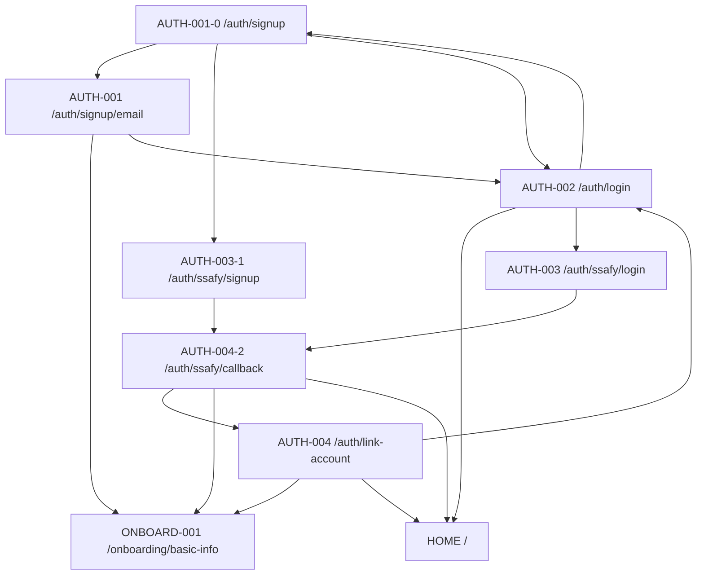
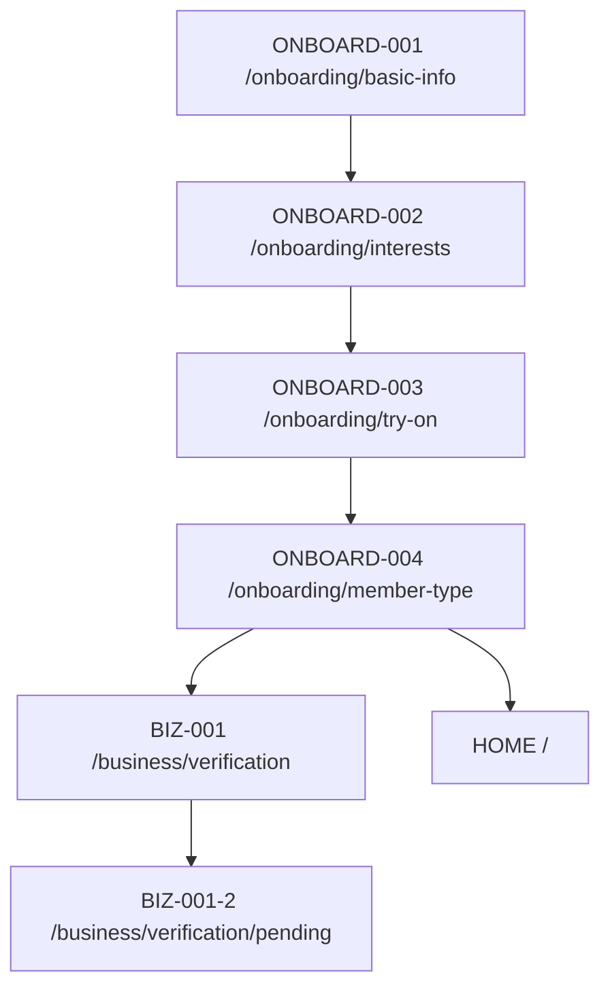
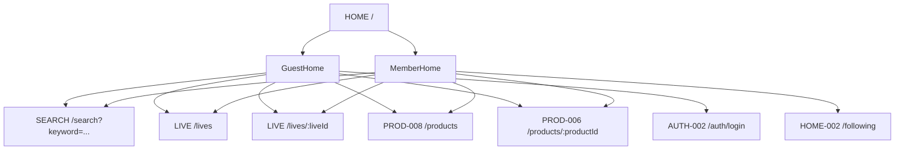
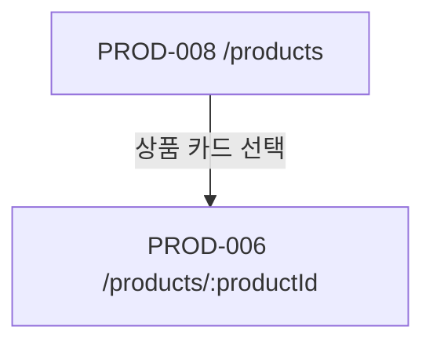
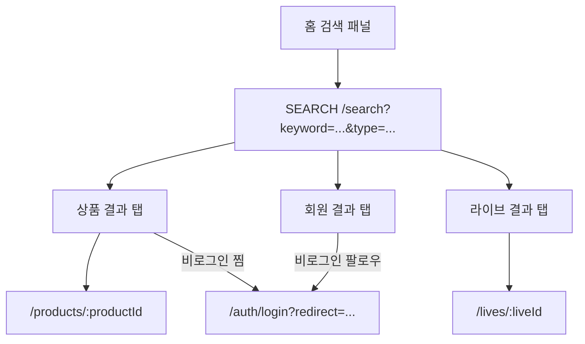

# 라우팅 및 화면 이동 초안

출처: `docs/notion/화면 기반 개발 요구 문서.md`

## 인증 흐름

## 온보딩 흐름

## 홈 흐름

## 상품 탐색 흐름

## 라우트 메타 초안

| 라우트                    | 화면        | requiresAuth | guestOnly | 비고                                             |
| ------------------------- | ----------- | ------------ | --------- | ------------------------------------------------ |
| `/auth/login`             | AUTH-002    | false        | true      | 이메일 로그인, SSAFY 로그인 진입                 |
| `/auth/signup`            | AUTH-001-0  | false        | true      | 회원가입 방식 선택                               |
| `/auth/signup/email`      | AUTH-001    | false        | true      | 회원가입 성공 후 `/onboarding/basic-info` 이동   |
| `/auth/ssafy`             | Legacy      | false        | true      | query 기준 SSO 로그인 또는 가입 route로 redirect |
| `/auth/ssafy/login`       | AUTH-003    | false        | true      | SSAFY 로그인 시작 화면                           |
| `/auth/ssafy/signup`      | AUTH-003-1  | false        | true      | SSAFY 가입 시작 화면                             |
| `/auth/ssafy/callback`    | AUTH-004-2  | false        | false     | SSO callback 처리                                |
| `/auth/link-account`      | AUTH-004    | false        | true      | 계정 연결 후보가 있을 때만 접근                  |
| `/onboarding/basic-info`  | ONBOARD-001 | false        | false     | 가입 후 필수/보완 흐름                           |
| `/onboarding/interests`   | ONBOARD-002 | false        | false     | 건너뛰기 가능                                    |
| `/onboarding/try-on`      | ONBOARD-003 | false        | false     | 건너뛰기 가능                                    |
| `/onboarding/member-type` | ONBOARD-004 | false        | false     | 회원가입 응답의 인증 토큰 계약 확정 전 임시      |
| `/business/verification`  | BIZ-001     | false        | false     | 사업자 회원 정보 제출, 인증 계약 확정 전 임시    |
| `/business/verification/pending` | BIZ-001-2 | false   | false     | FE 메모리 제출 상태가 없으면 BIZ-001로 이동      |
| `/`                       | HOME        | false        | false     | 로그인 상태에 따라 비로그인/회원 홈 렌더링       |
| `/following`              | HOME-002    | true         | false     | 팔로잉 홈 placeholder, 회원 홈 CTA에서 진입       |
| `/search`                 | SEARCH      | false        | false     | 홈 검색 패널에서 `keyword` query로 진입, 상세 UI 대기 |
| `/lives`                  | LIVE        | false        | false     | 라이브 목록 placeholder                          |
| `/products`               | PROD-008    | false        | false     | 공개 상품 목록 껍데기, 실제 조회 API 연동 대기   |
| `/products/:productId`    | PROD-006    | false        | false     | 상품 상세 408·410·412 UI, 실제 API 대기           |
| `/products/new`           | PROD 신규   | true         | false     | 상품 등록 placeholder                            |
| `/lives/new`              | LIVE 신규   | true         | false     | 라이브 시작 placeholder                          |
| `/lives/:liveId`          | LIVE 시청   | false        | false     | 라이브 시청 placeholder                          |
| `/notifications`          | NOTI        | true         | false     | 알림센터 placeholder                             |
| `/my`                     | MY          | true         | false     | 마이페이지 placeholder                           |
| `/points`                 | POINT       | true         | false     | 포인트 placeholder                               |

## 2026-07-28 검색 흐름 보강

| 라우트 | 화면 | requiresAuth | guestOnly | 비고 |
| --- | --- | --- | --- | --- |
| `/search` | SEARCH-001/002 | false | false | `keyword`, `type`, `categories`, `conditions`, `saleTypes`, `minPrice`, `maxPrice` query 기반 검색 결과 탭/필터/상태 화면. 실제 검색 API 대기 |
