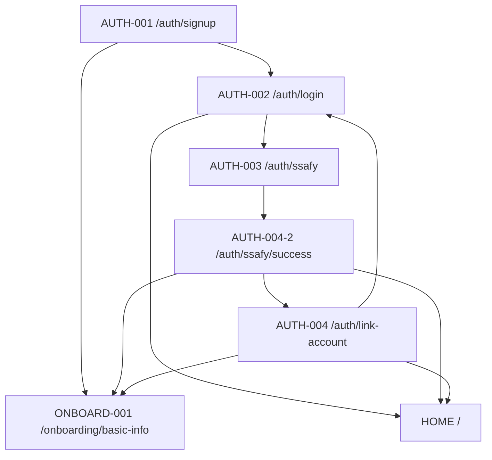
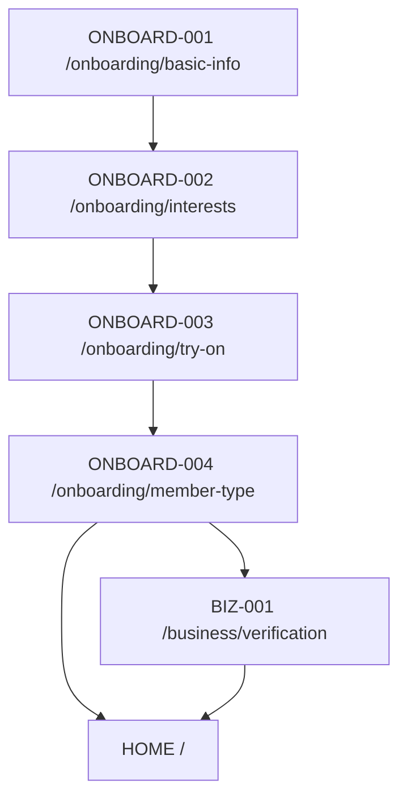

# 라우팅 및 화면 이동 초안

출처: `docs/notion/화면 기반 개발 요구 문서.md`

## 인증 흐름

## 온보딩 흐름

## 라우트 메타 초안

| 라우트                    | 화면        | requiresAuth | guestOnly | 비고                                           |
| ------------------------- | ----------- | ------------ | --------- | ---------------------------------------------- |
| `/auth/signup`            | AUTH-001    | false        | true      | 회원가입 성공 후 `/onboarding/basic-info` 이동 |
| `/auth/login`             | AUTH-002    | false        | true      | 로그인 후 기본 홈은 추후 서버 응답/상태 기준   |
| `/auth/ssafy`             | AUTH-003    | false        | true      | SSO 시작 화면                                  |
| `/auth/ssafy/success`     | AUTH-004-2  | false        | true      | SSO callback 결과 표시                         |
| `/auth/link-account`      | AUTH-004    | false        | true      | 계정 연결 후보가 있을 때만 접근                |
| `/onboarding/basic-info`  | ONBOARD-001 | true         | false     | 가입 후 필수/보완 흐름                         |
| `/onboarding/interests`   | ONBOARD-002 | true         | false     | 건너뛰기 가능                                  |
| `/onboarding/try-on`      | ONBOARD-003 | true         | false     | 건너뛰기 가능                                  |
| `/onboarding/member-type` | ONBOARD-004 | true         | false     | 일반/사업자 선택                               |
| `/business/verification`  | BIZ-001     | true         | false     | 사업자 회원 정보 제출                          |
