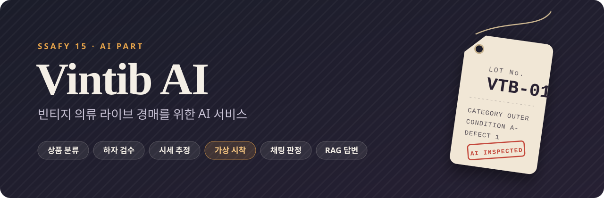
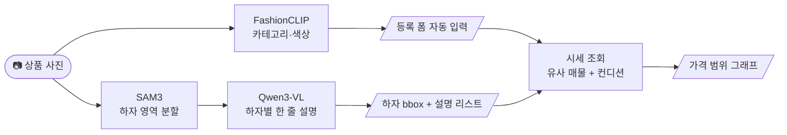
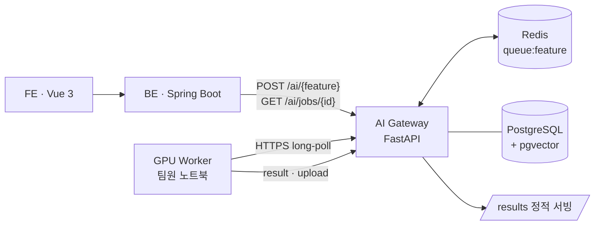

<div align="center">



<br/>


<br/><br/>

**사진만 올리면 분류·하자·시세가 채워지고, 라이브에서는 입어 보고, 묻고, 낙찰받는다.**<br/>
빈티지·세컨핸드 의류 라이브 경매 플랫폼 **Vintib**의 AI 파트입니다.

<sub>SSAFY 15기 공통 프로젝트 · 2026.07 – 2026.08</sub>

</div>

<br/>

<table>
  <tr>
    <td align="center" width="25%"><h3>8</h3><sub>AI 기능</sub></td>
    <td align="center" width="25%"><h3>6</h3><sub>GPU 워커 종류</sub></td>
    <td align="center" width="25%"><h3>0</h3><sub>운영 GPU 서버<br/>(노트북 워커로 대체)</sub></td>
    <td align="center" width="25%"><h3>98.8%</h3><sub>욕설 판정 악성 recall<br/>(라벨셋 N=210)</sub></td>
  </tr>
</table>

<br/>

## What the AI does

빈티지 의류는 상품마다 상태·희소성·가치가 달라 사진과 글만으로 정보를 전하기 어렵고, 정가가 없어 가격을 매기기도 어렵습니다.
AI 파트는 판매자의 **등록 부담**을 줄이고, 구매자가 **입어 보고 묻는 경험**을 라이브 안에서 해결하는 기능을 맡았습니다.

<table>
  <tr>
    <td width="50%" valign="top">
      <h3>🏷️ 상품 등록</h3>
      <ul>
        <li><b>카테고리·색상 자동 분류</b> — 폼을 먼저 채워 두고 판매자가 수정</li>
        <li><b>하자 검수</b> — 하자 영역 bbox + 하자별 한 줄 설명</li>
        <li><b>실측 사이즈</b> — A4 용지를 기준 물체로 cm 단위 추정</li>
        <li><b>시세 추정</b> — 유사 매물과 컨디션으로 가격 범위 제안</li>
      </ul>
      <sub>FashionCLIP 파인튜닝 · SAM3 · Qwen3-VL-4B (4bit) · HRNet · Gemini 검색 그라운딩</sub>
    </td>
    <td width="50%" valign="top">
      <h3>👕 가상 시착</h3>
      <ul>
        <li><b>내 사진에 입혀 보기</b> — 전신 사진 + 상품 이미지 합성</li>
        <li><b>핏 반영</b> — regular · oversized · cropped</li>
        <li><b>등록용 모델 컷</b> — 페르소나 사진으로 착용 컷 생성</li>
      </ul>
      <sub>Qwen3-VL 캡션 → 체형·핏 계산 → FLUX.2-klein-4B (GGUF)</sub>
    </td>
  </tr>
  <tr>
    <td width="50%" valign="top">
      <h3>💬 라이브 채팅</h3>
      <ul>
        <li><b>욕설·혐오·도배 판정</b> — AI는 판정만, 차단 집행은 BE</li>
        <li><b>반복 질문 자동 답변</b> — 방송 발언을 근거로, 근거가 없으면 답하지 않음</li>
        <li><b>라이브 자막용 STT</b></li>
      </ul>
      <sub>KcELECTRA-base-hate · faster-whisper · KURE-v1 · pgvector · LFM2.5</sub>
    </td>
    <td width="50%" valign="top">
      <h3>🧭 추천</h3>
      <ul>
        <li><b>유사 상품</b> — 의류 이미지 임베딩 코사인 유사도</li>
        <li><b>개인화 피드</b> — 인기 → 온보딩 → 행동 기반 콜드스타트 단계</li>
        <li><b>브랜드·상점 유사도 그래프</b> — 오프라인 사전계산</li>
      </ul>
      <sub>FashionCLIP 512-d · pgvector · numpy cosine</sub>
    </td>
  </tr>
</table>

## 상품 등록 파이프라인

판매자가 사진을 올리면 두 갈래가 병렬로 돕니다. 가벼운 분류가 폼을 먼저 채우고, 무거운 하자 검수는 비동기로 뒤따라옵니다.



## Architecture



| 설계 결정 | 이유 |
|---|---|
| **GPU 서버 없이 노트북 워커** | 운영 서버(EC2)에 GPU가 없습니다. 팀원 노트북이 워커가 되어 job을 가져가 추론합니다. |
| **Celery 대신 HTTPS 폴링** | Redis는 EC2 Docker 내부망에만 있고 포트를 열지 않습니다. 워커는 열린 유일한 경로(443)로 게이트웨이에 폴링하고, 게이트웨이가 대신 `RPUSH`/`BLPOP`을 합니다. |
| **입출력은 전부 URL** | Redis에 바이너리를 넣지 않습니다. 이미지는 업로드 후 URL로 주고받습니다. |
| **비동기 job + 재시도** | 접수 즉시 `job_id`를 반환하고 BE가 폴링합니다. `queued → processing → success / failed`, TTL 1시간, 3회 재시도 후 dead-letter. |
| **레지스트리로 모델 교체** | 모델마다 `*_BACKENDS` + `ACTIVE_*` 한 곳에서만 바꿉니다. 커밋 기본값은 `mock`이라 CI와 로컬이 GPU·외부 API 없이 돌아갑니다. |

## Results

| 항목 | 데이터 | 결과 |
|---|---|---|
| 욕설 판정 모델 비교 | 라벨셋 210건 | **KcELECTRA-base-hate** 정확도 99.5% · 악성 recall 98.8%<br/>kor_unsmile 악성 recall 58.3% · 규칙 기반 recall 16.7% |
| 반복 질문 묶기 | 325쌍, 임계치 0.30 | precision 87.5% · recall 95.5% |

규칙 기반 판정기의 recall이 16.7%에 그쳐 기본 판정기를 KcELECTRA로 교체했습니다.
<sub>출처: `AI/app/chat/registry.py`, `AI/validation/model_selection/classifier_benchmark.ipynb`, `AI/docs/chat-rag-verification-results.md`</sub>

<br/>

<details>
<summary><b>API</b></summary>

<br/>

| Method | Endpoint | 설명 |
|---|---|---|
| `POST` | `/ai/{feature}` | 워커 job 접수 (`tryon`, `quality_check`, `stt`, `chat_rag`, `garment_measurement`, `product_classifier`) |
| `GET` | `/ai/jobs/{job_id}` | job 상태·결과 조회 |
| `POST` | `/ai/tryon/registration-model-cut` | 등록용 모델 착용 컷 |
| `POST` | `/quality/inspections` | 하자 검수 |
| `POST` | `/product-classifier/classify` | 카테고리·색상 분류 |
| `POST` | `/measurement/scans` | 실측 사이즈 |
| `POST` | `/pricing/estimates` | 시세·가격 범위 |
| `POST` | `/chat/moderate` | 채팅 메시지 판정 |
| `GET` | `/chat/lives/{live_id}/answers` | 반복 질문 답변 |
| `GET` | `/recommend/products` | 개인화 피드 |
| `GET` | `/recommend/products/{product_id}/similar` | 유사 상품 |
| `GET` | `/recommend/graph` | 브랜드·상점 그래프 |
| `GET` `POST` | `/ai/workers/poll` · `/ai/workers/result` | 워커 전용 (`X-API-Key`) |

자세한 계약은 [`AI/docs/api-reference.md`](AI/docs/api-reference.md)를 참고하세요.

</details>

<details>
<summary><b>Directory</b></summary>

<br/>

```
AI/
├── app/                    # FastAPI 프로덕션 코드 (도메인 단위)
│   ├── gateway/            #   job 큐 · 워커 poll/result · 파일 업로드
│   ├── tryon/              #   가상 시착 · 등록용 모델 컷
│   ├── quality/            #   하자 검수 · attention map
│   ├── product_classifier/ #   카테고리·색상 분류
│   ├── measurement/        #   실측 사이즈
│   ├── pricing/            #   시세 수집 · 속성 추출 · 가격 산정
│   ├── chat/               #   채팅 판정 · FAQ/RAG · 평가 파이프라인
│   └── recommend/          #   유사 상품 · 개인화 · 브랜드 그래프
├── test/                   # pytest (도메인별 + 워커 단위)
├── validation/             # 모델 선정·PoC 노트북
└── docs/                   # 아키텍처 · API · 고도화 전략

worker/
├── base_worker.py          # 폴링 · 결과 제출 · 재시도 공통 로직
├── *_worker_example.py     # tryon · quality_check · product_classifier
│                           # garment_measurement · stt · chat_rag
└── models/                 # 모델별 백엔드 레지스트리
```

</details>

<details>
<summary><b>Run locally</b></summary>

<br/>

```bash
cd AI
python -m venv .venv && source .venv/bin/activate
pip install -r requirements-dev.txt
cp .env.example .env
uvicorn app.main:app --reload --port 8000
```

워커 실행과 모델별 환경은 [`worker/README.md`](worker/README.md), EC2 배포·테스트는 [`AI/docs/testing-guide.md`](AI/docs/testing-guide.md)를 참고하세요.

</details>

<br/>

<div align="center">
<sub>이 저장소는 GitLab 모노레포(<code>AI/</code> · <code>BE/</code> · <code>FE/</code> · <code>infra/</code>)의 미러이며, 이 문서는 <code>AI/</code>와 <code>worker/</code>를 소개합니다.</sub>
</div>
